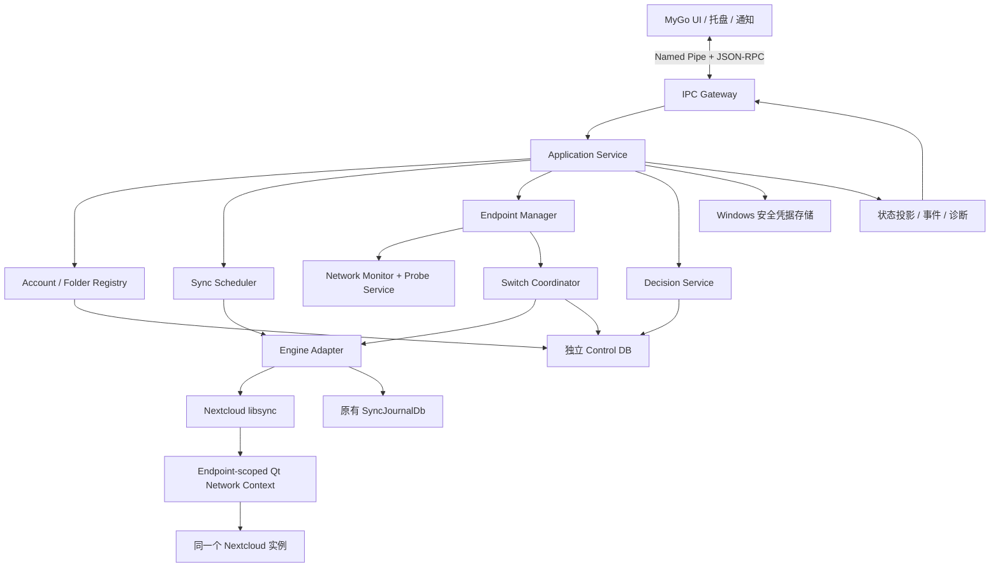
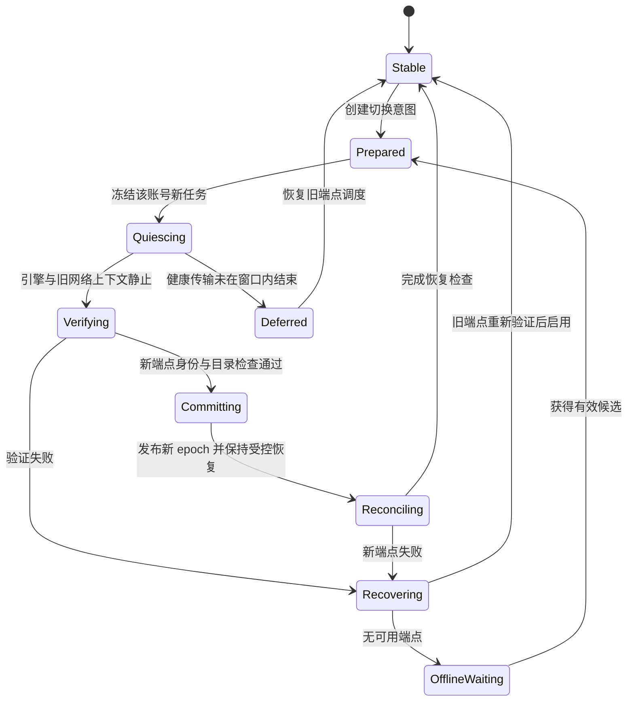

# PLAN：Nextcloud-MyGo 后端架构与算法策略

> 文档日期：2026-11-03  
> 项目名称：**Nextcloud-MyGo**；Logo：**沿用 Nextcloud 图标**。  
> 目标：复用 Nextcloud Desktop 同步引擎，构建支持网络感知、多地址切换和 Windows ARM64 的独立桌面客户端。  
> 本文交付：架构、算法、数据模型、接口契约、实施顺序和验收标准。本文不包含产品实现代码；伪代码与 JSON 仅用于定义行为。  
> 分工：本计划负责后端设计；前端 Agent 负责 MyGo 界面设计与实现；后续编码 Agent 按本计划实现和验证后端。  
> 输入：[原始 Nextcloud Plan 对话](chatgpt-conversation://6ae0d122-5de0-83e9-83de-a16a5f07e872)。对话中的建议经过本次复核和细化，不视为已经完成的工程验证。

## 0. 核心决策与阅读方式

采用 **MyGo UI + 独立 C++/Qt SyncD + Nextcloud 上游同步引擎**。UI 通过本地 Named Pipe 调用 SyncD；同步、凭据、端点选择和恢复决策全部由 SyncD 持有。

优先级固定为：**数据完整性 > 凭据与服务器身份安全 > 断网恢复与地址切换 > ARM64 原生运行 > 界面体验 > 系统深度集成**。ARM64 是首版发布门槛，不能以优先级排序为由推迟到“未来支持”。

| 主题 | 首版决策 | 理由 |
|---|---|---|
| 项目名称与 Logo | 名称固定为 Nextcloud-MyGo，沿用 Nextcloud 图标 | 用户已确定，前端与发布材料统一执行 |
| 文件同步算法 | 复用上游 discovery / reconcile / propagator / journal | 避免重新实现双向同步和冲突判定 |
| 进程边界 | UI 与同步服务分离，无 Go → C++ CGO 嵌入 | 隔离运行时、生命周期和崩溃 |
| 服务运行方式 | 当前用户的后台进程，非 LocalSystem Windows Service | 使用用户凭据、配置和文件权限 |
| 同步并发 | 一个 SyncD 进程同时只运行一个 SyncEngine 周期 | 遵循已观察到的上游进程级运行限制 |
| 网络切换单位 | 同一个账号的全部目录统一切换 | 防止同一账号同时使用不一致的连接上下文 |
| 切换时机 | 引擎进入可证明的静止边界后切换 | 不在传输过程中重写 URL |
| 账号标识 | 固定 `accountId`、规范 URL、凭据引用、目录 ID | 网络路径变化不改变逻辑身份 |
| 备用地址信任 | 用户明确登记地址关系，再验证账号及远程命名空间 | 不能靠 SSID、相同用户名或版本号自动建立信任 |
| 路由实现 | 端点级运行时 Account 上下文 + 稳定凭据适配器 | 首版避免在底层全局替换所有请求 URL |
| IPC | Named Pipe + JSON-RPC 2.0 + 显式消息分帧 | 可由 Go / C++ 独立实现和测试 |
| 首版平台 | Windows 11 x64 与原生 ARM64 | 控制验证矩阵 |
| 首版文件模式 | 普通完整文件双向同步 | CFAPI、占位文件和 Shell 扩展后置 |
| 发布方式 | 前后端作为一个经过验证的版本组合交付 | 防止 UI、协议、引擎和 journal 迁移版本错配 |

本文中的“必须”是实现约束；“默认”是建议配置，后续可依据测量调整；“待验证”必须形成实验结果，不能由编码 Agent 默认为已支持。所有性能指标都是验收目标，不是现成性能承诺。

建议阅读顺序：

1. 后端编码 Agent：先读第 1–6 节，按第 18 节里程碑实施。
2. 算法实现：重点读第 7–12 节及第 20 节测试矩阵。
3. 前端 Agent：只需重点读第 13 节 IPC、第 17 节界面要求和第 19 节交接清单。
4. 发布维护：重点读第 14–16 节与第 21–23 节。

## 1. 已核对的事实及原讨论中的修正

本次查阅的是官方文档和上游可见源码；没有编译或运行 Nextcloud、MyGo，也没有接入实际服务器。`master` 和 `latest` 链接会变化。M0 必须选择发行基线并锁定 commit、依赖版本与文档对应版本，不能直接把本次网页快照当作一致的构建环境。

| 事实 | 对方案的影响 | 来源 |
|---|---|---|
| 上游 CMake 包含 `BUILD_GUI`、`BUILD_LIBRARIES_ONLY` 等开关 | 可从命令行路径验证无可见 GUI 的同步，但不代表零 GUI 库依赖 | [根 CMakeLists](https://github.com/nextcloud/desktop/blob/master/CMakeLists.txt) |
| `nextcloudcmd` 直接创建 `SyncEngine` | 可以参考初始化顺序；不能把循环启动命令行工具作为最终服务 | [cmd.cpp](https://github.com/nextcloud/desktop/blob/master/src/cmd/cmd.cpp) |
| `SyncJournalDb` 的头文件位于 `src/common/`，命名函数接收远程 URL 等参数 | 修正原讨论中的目录归属；journal 位置必须独立于活跃端点 | [syncjournaldb.h](https://github.com/nextcloud/desktop/blob/master/src/common/syncjournaldb.h) |
| `SyncEngine` 实现包含 `s_anySyncRunning` 检查 | 首版不能承诺同进程多个目录并行跑完整同步周期 | [syncengine.cpp](https://github.com/nextcloud/desktop/blob/master/src/libsync/syncengine.cpp) |
| `Folder` / `FolderMan` 中存在 GUI 引用 | 需要抽取业务职责和替换交互点，不能直接复制后宣称已解耦 | [folder.cpp](https://github.com/nextcloud/desktop/blob/master/src/gui/folder.cpp)、[folderman.cpp](https://github.com/nextcloud/desktop/blob/master/src/gui/folderman.cpp) |
| Account URL 和凭据存取存在耦合 | 动态调用 `Account::setUrl()` 不是完整的端点切换方案 | [account.cpp](https://github.com/nextcloud/desktop/blob/master/src/libsync/account.cpp)、[httpcredentials.cpp](https://github.com/nextcloud/desktop/blob/master/src/libsync/creds/httpcredentials.cpp) |
| Login Flow v2 使用浏览器与轮询取得应用密码 | 由 SyncD 管理登录事务，UI 不接收应用密码 | [Login Flow](https://docs.nextcloud.com/server/latest/developer_manual/client_apis/LoginFlow/index.html#login-flow-v2) |
| DAV 的 `oc:id` 是带实例命名空间的文件标识，`oc:fileid` 是实例内标识 | 优先比较完整 `oc:id`；不要把单个数字 fileid 当作服务器身份证明 | [WebDAV 属性](https://docs.nextcloud.com/server/latest/developer_manual/client_apis/WebDAV/basic.html) |
| MyGo 文档列出 `windows/arm64`，Qt 文档列出 Windows ARM64 配置 | 说明工具链存在支持路径；完整产品仍需 ARM64 真机验收 | [MyGo 构建](https://mygo.egoist.dev/docs/distribution)、[Qt Windows](https://doc.qt.io/qt-6/windows.html) |

补充约束：

- 原对话对“官方 Files 客户端是否提供 ARM64”出现过自我修正。本文不依赖该判断，也不把 Office Desktop Editors 当成 Files 同步客户端。
- 不固定沿用原对话中的 Qt、Nextcloud 或 MyGo 版本号；以 M0 锁定组合为准。
- `BUILD_GUI=OFF` 不能被解释为只需要 Qt Core/Network；可见的 [src/CMakeLists](https://github.com/nextcloud/desktop/blob/master/src/CMakeLists.txt) 仍包含其他 Qt 模块查找。
- 可见根构建脚本在关闭 GUI 时可能跳过上游测试目标。验证必须同时包含“上游测试构建”和“服务构建”，不能把“没有测试被执行”报告成通过。[构建依据](https://github.com/nextcloud/desktop/blob/master/CMakeLists.txt)

## 2. 产品范围与成功定义

### 2.1 首版 MVP

必须形成以下完整闭环：

1. 通过系统浏览器登录现有 Nextcloud 账号。
2. 添加本地普通目录与远程目录映射。
3. 完成新增、修改、重命名、删除和双向冲突处理。
4. 支持暂停、恢复、立即检查和退出后继续后台同步。
5. 配置同一实例的 WAN / LAN 地址，允许扩展 VPN 地址。
6. 在已建立信任的端点间自动选择和安全切换。
7. 显示当前端点、切换原因、同步状态、错误及需要用户处理的事项。
8. 断网、休眠、进程崩溃后能够恢复，不靠删除同步数据库“修复”。
9. 在 Windows 11 ARM64 上运行原生前端、后端及所有加载的运行时依赖。
10. 提供 x64 对照构建，完成安装、升级、卸载和共存测试。

数据模型从第一天支持多账号、多目录。MVP 验收至少覆盖 2 个账号、每账号 2 个目录；完整同步周期仍全局串行。UI 可以先提供单账号顺畅流程，再开放多账号管理。

### 2.2 后置能力

| 能力 | 首版处理 | 后续方向 |
|---|---|---|
| CFAPI / Virtual Files | 禁止创建、接管占位文件目录 | 独立阶段接入上游 VFS 和 Windows API |
| Explorer 图标和右键菜单 | 只提供从 UI 打开本地目录 | 后续使用独立标识注册 Shell 扩展 |
| E2EE 端到端加密目录 | 不允许当作普通目录同步；检测到即阻止该范围并说明原因 | 专项验证密钥、恢复和跨端点语义 |
| 公共分享链接同步 | 不纳入首版 | 使用独立账号/认证类型设计 |
| 服务器迁移或跨实例复制 | 不属于地址切换 | 单独制定迁移流程和新同步基线 |
| SMB/UNC、可移动磁盘、嵌套同步根 | 首版拒绝新增 | 逐类补充文件系统与掉盘语义 |
| Linux/macOS | 保留接口抽象 | 不承诺首版发布 |
| 上传中无缝迁移请求 | 不提供 | 后续单独研究，不能改变首版可靠性约束 |
| 多副本自动择优写入 | 不支持 | 需服务器一致性保证，客户端选址算法无法替代 |
| 自动内容合并 | 不自行实现 | 使用上游冲突副本与人工处理 |

### 2.3 完成标准

- “地址切换成功”意味着新端点经验证、旧上下文已静止、同一 journal 被继续使用，并能完成后续同步。
- 允许必要的元数据重新发现；**不允许仅因换地址而重建 journal 或重新传输所有未变化文件**。
- “原生 ARM64”必须有进程和依赖架构检查，以及真机测试记录；交叉编译成功不是最终证明。
- “关闭窗口后继续同步”必须在 UI 进程实际退出后验证，不能仅测试最小化到托盘。
- 不以静态界面、模拟进度或手动运行 `nextcloudcmd` 代替端到端交付。

## 3. 数据安全不变量

编码 Agent 必须把下列约束转换成断言、测试或运行时检查：

| 编号 | 不变量 |
|---|---|
| INV-01 | 一个同步根在任一时刻只能有一个 journal 写入者和一个文件同步所有者 |
| INV-02 | 同一个逻辑目录的 `folderId`、远程根身份和 journal 路径不随端点变化 |
| INV-03 | 只向已获凭据发送许可且通过 TLS 校验的精确 origin 发送账号凭据 |
| INV-04 | TLS、账号或命名空间身份失败的端点不能通过高评分重新进入候选集 |
| INV-05 | 正在运行的同步周期只使用一个不可变的 `endpointEpoch` |
| INV-06 | 旧 epoch 的异步完成事件不能推动新 epoch 的状态或释放新周期的锁 |
| INV-07 | 网络断开、目录无法读取、服务器维护或 DAV 解析失败不等于“目录为空” |
| INV-08 | 不通过删除、替换或手写修正 journal 来绕过错误 |
| INV-09 | 未确认的远程写入结果只能经重新发现恢复，不能假设请求失败就一定未执行 |
| INV-10 | 发生身份变化、根目录替换、数据库损坏时，先停止受影响范围的写入 |
| INV-11 | UI 断开、重启或发送重复命令不产生重复账号、目录或破坏性动作 |
| INV-12 | 未收到 IPC 回复不能被解释为命令未执行，必须按 operationId 查询 |
| INV-13 | 用户暂停、凭据失效、端点切换等阻塞原因独立保存，不能互相覆盖 |
| INV-14 | 自动恢复不撤销用户暂停、不静默接受证书变化、不扩充受信任地址列表 |
| INV-15 | 一个端点可访问不等于它指向正确实例，更不等于其数据副本是最新的 |

账号逻辑身份与网络地址的关系：

```text
Logical Account
  accountId                 永久本地 UUID
  canonicalBaseUrl          登录、用户展示、浏览器链接的规范地址
  credentialRef             稳定安全存储引用
  namespaceBinding          经登记和验证的账号/远程根关系
      |
      +-- Endpoint WAN      https://cloud.example.com/
      +-- Endpoint LAN      https://cloud.lan.example/
      +-- Endpoint VPN      https://cloud.vpn.example/

FolderBinding
  folderId + localRootIdentity + remoteRootIdentity + journalPath
  不包含 activeEndpoint 作为持久身份的一部分
```

## 4. 总体架构与进程生命周期

### 4.1 组件图



### 4.2 模块职责

| 模块 | 拥有的状态 | 允许执行的职责 | 禁止承担的职责 |
|---|---|---|---|
| Application Service | 操作事务、版本、生命周期 | 校验命令、协调各模块 | 实现文件级合并算法 |
| Account Registry | 账号逻辑身份、策略 | 登录状态、凭据引用、端点登记 | 根据网络直接修改永久账号 URL |
| Folder Registry | 同步映射、暂停设置、根身份 | 配置验证、重叠检测 | 自行修改上游 journal 表 |
| Engine Adapter | 当前引擎及运行上下文 | 生命周期、事件转换、静止确认 | 向 UI 暴露 C++ 指针或内部类 |
| Sync Scheduler | 到期队列、dirty generation | 去抖、公平调度、重试 | 重排 propagator 内部文件依赖 |
| Endpoint Manager | 健康、评分、候选 | 采集和决策 | 未经 Switch Coordinator 直接替换连接 |
| Switch Coordinator | 切换意图、epoch、阶段 | 冻结、静止、验证、切换、恢复 | 回滚已经发生的远程文件变化 |
| Credential Store | 应用密码和秘密引用 | 安全存取、删除、续期接入 | 把秘密写入 Control DB 或日志 |
| Decision Service | 待确认提案 | 一次性确认、失效、拒绝 | 越过身份或 TLS 硬性阻断 |
| IPC Gateway | 会话、请求关联、订阅游标 | 鉴权、分帧、限流、版本协商 | 接受任意 shell/SQL/文件系统命令 |
| Diagnostics | 脱敏事件、指标、支持包 | 定位故障 | 默认导出完整路径或凭据 |

### 4.3 线程和对象归属

- SyncD 使用 Qt 事件循环。Account、SyncEngine、QNAM、切换状态机归属固定的控制线程。
- 不从 Go、Windows 网络回调或任意线程直接调用 Qt 对象。
- 网络通知和 Windows 管道 IO 经队列投递到控制线程；携带 generation / epoch。
- 文件枚举、哈希与 IO 尽量沿用上游已有执行模型；新增后台任务仅返回不可变结果。
- SQLite 连接按其线程规则使用；不能共享一个连接在多个线程并发访问。
- 首选 `QCoreApplication`；M0 若发现不可去除的 GUI 初始化依赖，记录最小依赖和调整方案，不以一个隐藏 GUI 冒充完成服务化。
- 可暂时链接上游需要的 Qt GUI 库，但最终服务不得需要可见窗口、交互式弹窗或 UI 才能继续运行。

### 4.4 用户进程模型

1. UI 启动时先连接已有 SyncD。
2. 不存在时，由受控启动器从安装目录的绝对路径启动 SyncD。
3. SyncD 获取 profile 独占锁和进程单实例锁，再打开 Control DB。
4. 每个同步根还要获取独立的系统级所有权锁；锁不放在会被同步到服务器的文件里。
5. 关闭窗口与退出 UI 不影响 SyncD；“退出并停止同步”调用明确的停止接口。
6. 开机启动按用户设置注册。首版后台重启可由当前用户的计划任务承担；不引入常驻第三个业务服务。
7. 崩溃重启退避建议 2、5、15、60 秒；10 分钟内超过 5 次进入诊断状态，避免重启风暴。
8. 用户显式停止时保存“本次不自动拉起”意图，启动器不得误判为崩溃。
9. 同一 Windows 用户的多个登录会话争用同一 profile 时，仅一个会话拥有同步服务；另一会话显示已被占用，不能建立第二个写入者。
10. 持有锁的进程尚未确认退出前，不允许凭“心跳超时”抢锁。

### 4.5 与官方客户端共存

- 产品名称使用 **Nextcloud-MyGo**，应用 Logo 沿用 Nextcloud 图标。
- 配置目录、更新通道、IPC 名称和安装标识使用 Nextcloud-MyGo 自身的标识，与官方客户端分离。
- 首版不自动导入官方客户端的账号、journal、VFS 注册或 Shell 配置。
- 若发现目标目录由其他同步客户端管理，阻止接管并要求用户先解除原同步关系。
- 自有锁不能阻止不认识该锁的官方客户端；因此还须检测已知 journal/配置痕迹，并在产品流程中明确避免双客户端管理同一目录。
- 复用源码不等于运行时复用官方安装中的 DLL。发布包必须自带经过验证的匹配依赖。

## 5. 上游复用和适配边界

### 5.1 复用清单

| 上游区域 | 策略 | 编码 Agent 的核查重点 |
|---|---|---|
| `src/libsync/syncengine.*` | 保留算法，使用 Adapter 包装 | 全局串行限制、abort/finalize、传播前交互点 |
| discovery / propagator / 各传输 job | 原则上保持原行为 | URL 构造、恢复记录、取消后生命周期 |
| `src/common/syncjournaldb.*` | 保留数据结构和迁移职责 | 命名规则、WAL、锁、恢复和关闭完成信号 |
| `src/libsync/account.*` | 作为运行时网络账号上下文 | 永久身份与连接地址解耦 |
| `src/libsync/creds/` | 保留认证方式，新增稳定引用适配 | 所有 fetch/persist/delete、认证头注入边界 |
| `src/gui/folder.*` | 提取目录生命周期职责 | QFileSystem watcher、错误分类、用户决策 |
| `src/gui/folderman.*` | 参考调度行为，形成独立 Scheduler | 公平性、定时检查、跟随同步请求 |
| AccountState / AccountManager | 提取非可视职责 | 配置保存、重新认证、状态聚合 |
| `src/cmd/` | 用于无 GUI 验证与初始化参考 | 不将 CLI 的交互输入和一次性退出模式复制进服务 |
| Shell / VFS | 首版隔离，保留后续接入点 | 禁止未完成时误启用相关目录 |

### 5.2 端点级运行时上下文：首版选定方案

定义三个层次：

1. **LogicalAccount**：永久账号信息，保存在 Control DB。
2. **EndpointRuntime**：针对一个已验证地址创建的上游 Account、凭据适配器、QNAM、cookies、capabilities 和网络 job 管理器。
3. **SyncRunContext**：一次同步周期的不可变快照，绑定 runtime、folder、journal、epoch 和 policyRevision。

切换时销毁或退休旧 EndpointRuntime，再创建新 EndpointRuntime；同一个运行中的 Account 不直接换 URL。

必须处理的细节：

- Credential Adapter 从固定 `credentialRef` 取得秘密，不根据临时 URL 生成新的存储键。
- 禁止旧 credentials 实现的自动持久化或删除操作悄悄生成第二套端点相关凭据；所有读、写、删除、认证回调都要审计。
- folder 的 journal 路径在首次建立后保存并重复使用；如参考 `makeDbName`，仅在建档时使用固定规范身份。
- 向 SyncEngine 提供明确的已选 journal 对象，不能在每次换 runtime 时按端点重新计算。
- 运行时 Account 的 URL 可以是选中端点，但 UI 展示、浏览器分享链接及永久配置读取 LogicalAccount 的规范地址。
- 重建端点上下文时重新取得 capabilities、用户信息和必要 DAV 路径；不复制跨 origin cookie、TLS 会话或认证缓存。
- 服务推送、分享、头像、配额等后台 job 也必须纳入上下文生命周期。首版不实现的后台功能直接关闭，不能留下不受控的旧端点请求。
- 运行时账号 ID、DAV 用户名与上游缓存键的关系必须在 M0/M1 中验证；不假定“更换一个 Account 对象不会影响其他行为”。

**这是一个需要源码适配和集成测试的设计，不是上游已有的稳定 SDK 能力。** 若该方案无法在固定 journal 和稳定凭据下成立，M0/M3 必须出具具体阻塞点和最小补丁；不悄悄退化为修改配置文件。

### 5.3 URL 使用面审计

逐项建立 `url-usage-audit.md`：

| 使用面 | 必须验证的行为 |
|---|---|
| DAV 文件请求 | 正确组合 origin、安装子路径、DAV 用户和文件相对路径 |
| MOVE / COPY 的 Destination | 源、目标使用同一个 runtime；禁止跨实例目的地址 |
| 207 Multi-Status 的 href | 处理相对或绝对地址；越出允许前缀即失败，不能字符串全局替换 |
| 分块上传 | 上传集合、最终 MOVE、重试缓存对端点变化的依赖 |
| 下载直链 | 首版关闭跨 origin 直链优化；未验证的直链不附带账号 Authorization |
| 重定向 | 每跳验证新目标；禁止自动跨 origin 发送凭据 |
| 登录、OCS、capabilities | 明确由规范地址还是 runtime 地址负责 |
| push/WebSocket | 首版可关闭；后续重连必须绑定 epoch 和独立信任检查 |
| 服务器返回的用户链接 | 不能当作允许发送凭据的新端点 |
| 签名 URL / 查询参数 | 不重写签名内容，不写日志，不误用普通 URL 归一化规则 |

### 5.4 最小上游补丁集合

预期允许的补丁主题：

- 稳定凭据引用及 origin 发送许可。
- 无 UI 的用户决策回调。
- 可验证的传播前安全检查点。
- runtime 生命周期、请求追踪和取消完成桥接。
- 构建裁剪、产品隔离和 ARM64 工具链适配。

每个补丁记录：修改原因、适用 commit、涉及的上游类、测试、上游升级冲突处理方式。禁止为了前端方便修改文件冲突判定、journal schema 或删除安全逻辑。

## 6. 持久数据模型

### 6.1 存储分层

| 存储 | 内容 | 所有者 |
|---|---|---|
| Control DB | 账号、目录映射、端点、策略、操作、确认、事件 | SyncD |
| 上游 SyncJournalDb | 文件同步基线、传输恢复、上游内部记录 | 上游引擎 |
| Windows 安全存储 | 应用密码、私钥密码等 | Credential Store |
| 内存 | 当前连接、探测结果、分数、短期进度 | 对应模块 |
| 日志目录 | 脱敏结构化诊断、轮转日志 | Diagnostics |

Control DB 与每个 journal 不使用跨库“假事务”。恢复以显式状态机协调，不能声称能够原子提交本地配置、journal 和远程服务器。

### 6.2 核心实体

| 实体 | 核心字段 | 约束 |
|---|---|---|
| Account | `accountId, canonicalBaseUrl, loginName, davUserId, credentialRef, revision, userPaused` | accountId 为本地 UUID；登录名和 DAV 用户 ID 分开 |
| Endpoint | `endpointId, accountId, baseUrl, origin, enabled, priority, profileRules, revision` | baseUrl 含安装子路径；地址修改视为重新登记 |
| EndpointBinding | `endpointId, bindingRevision, trustMode, credentialSendAllowed, namespaceVerified, approvedOrigin, accountUserId, verifiedAt` | 不以一个布尔值混合“准许发凭据”和“允许自动切换” |
| EndpointRootBinding | `endpointId, folderId, davRootOcId, remotePath, verifiedAt` | 新增目录后，各端点必须补验证该根 |
| Folder | `folderId, accountId, localPath, volumeId, directoryFileId, remotePath, remoteRootOcId, journalPath, mode, revision, userPaused` | 一个根对应一个固定 journal |
| NetworkPolicy | `policyId, mode, margin, dwell, cooldown, meteredPolicy, revision` | 策略修改使旧候选和旧提案失效 |
| SwitchOperation | `operationId, accountId, fromEndpointId, toEndpointId, phase, expectedEpoch, targetEpoch, reason, createdAt` | 每账号最多一个进行中的切换 |
| PendingDecision | `decisionId, kind, folderId, proposalDigest, bindingRevision, policyRevision, epoch, expiresAt, state` | 一次性；过期或条件变化后必须重新生成 |
| Operation | `operationId, operationKey, method, targetId, requestDigest, state, result, error` | operationKey 唯一；同 key 不同输入返回冲突 |
| EventOutbox | `seq, type, entityId, entityRevision, payload, createdAt` | 控制状态与持久事件在同一事务提交 |

`endpointEpoch`、事件序列号和长期计数在 IPC 中采用十进制字符串，避免 JavaScript 对大整数的精度损失。数据库内部可使用相应整数类型。

### 6.3 配置示例

以下是配置导出视图，不是 SQLite schema，也不包含秘密：

```json
{
  "schemaVersion": 1,
  "account": {
    "accountId": "acc-01",
    "canonicalBaseUrl": "https://cloud.example.com/",
    "loginName": "alice@example.com",
    "davUserId": "alice",
    "credentialRef": "secure-store:acc-01:app-password",
    "policyMode": "auto",
    "lastSelectedEndpointId": "ep-wan"
  },
  "endpoints": [
    {
      "endpointId": "ep-wan",
      "baseUrl": "https://cloud.example.com/",
      "priority": 50,
      "bindingState": "verified"
    },
    {
      "endpointId": "ep-lan",
      "baseUrl": "https://cloud.lan.example/",
      "priority": 90,
      "bindingState": "unverified",
      "preferredProfile": "home"
    }
  ],
  "folders": [
    {
      "folderId": "folder-01",
      "localPath": "C:/Users/Alice/CloudFiles",
      "remotePath": "/Documents",
      "journalRef": "folder-01-journal",
      "mode": "full"
    }
  ]
}
```

导入该文件不自动恢复端点信任或秘密访问权限。`lastSelectedEndpointId` 只是启动提示，不能证明当前连接仍然有效。

### 6.4 路径与持久化规则

- 本地根路径使用 Windows 真实路径和卷/目录身份校验；字符串大小写或盘符相同不足以判定同一目录。
- 检查相等、祖先/后代、junction/reparse point 别名导致的重叠。首版拒绝重解析点同步根及不受控的链接遍历。
- 远程路径必须使用已验证 DAV 用户 ID，并通过 URL API 按段编码；不能用登录邮箱拼接用户目录。
- URL 接受 HTTPS，保留有效端口和安装子路径；拒绝 userinfo、fragment、含秘密的查询参数和模糊路径。
- 不把整个 URL 转小写；仅规范化 scheme、host 和默认端口，保留路径语义。
- Control DB 事务、revision 比较和 outbox 一起提交；写失败时不发布“成功”事件。
- 凭据与数据库之间通过 `CREATING → READY` 的可恢复建档状态协调；失败留下的安全存储孤儿引用必须有清理流程。
- journal 备份只能在停止写入后或使用其支持的一致性备份方法完成；不能随意复制一个正在写 WAL 的单文件。
- 删除账号/映射只解除管理关系并处理凭据，不自动删除本地文件或远程文件。

## 7. 认证、端点登记与信任策略

### 7.1 首次登录

采用 Nextcloud Login Flow v2。SyncD 发起登录并保管轮询 token，UI 只取得浏览器登录地址和临时 `loginSessionId`。成功后获得的应用密码直接进入安全存储；登录名与 DAV 用户 ID 独立确认。v2 轮询尚未完成时的 404 是正常等待状态，不能按“服务器不存在”处理。[协议依据](https://docs.nextcloud.com/server/latest/developer_manual/client_apis/LoginFlow/index.html#login-flow-v2)

详细流程：

1. 校验用户输入的规范地址，默认补全 HTTPS；不静默降级到 HTTP。
2. 无凭据访问必要的发现/登录接口，验证 TLS 与响应结构。
3. 检查返回的浏览器地址、轮询地址是否属于本次明确认可的服务器。
4. 若登录接口返回了另一 origin 的轮询地址，暂停流程并要求登记该地址；不直接把 token 发过去。
5. 系统浏览器负责密码、SSO 和 MFA；应用不读取浏览器密码或 cookie。
6. SyncD 以建议 1–2 秒间隔轮询，并遵守服务端超时及限流；登录会话最长不超过协议有效期。
7. 收到应用密码后立即安全保存，再完成账号建档。不能依赖轮询成功结果可重复取得。
8. 通过认证后的用户信息取得 DAV 用户 ID，建立基础命名空间记录。
9. 账号进入可配置目录状态后，才允许创建同步映射。
10. UI 取消、登录超时、SyncD 重启时使本地会话失效；不得把旧会话和新登录结果串接。

处理登录响应中的 `server` 字段时，不自动修改已有账号的 canonical URL。新账号可以在明确检查规范化结果后采用服务器返回地址；已有账号如发生 origin 变化，进入重新绑定流程。

### 7.2 凭据存储和使用

- 使用 QtKeychain 的 Windows 安全后端或等效的 Windows 安全存储；禁止明文 fallback。
- 安全存储键按 `product/profile/accountId/credentialType` 构造，不包含活跃端点。
- IPC 不返回应用密码、Authorization、轮询 token 或客户端私钥。
- 非秘密登录 URL 也可能携带一次性授权上下文，因此不写常规日志，不进入活动历史。
- 使用应用密码时沿用上游认证实现；新增发送许可检查必须位于附加 Authorization 之前。
- 凭据只对精确的 scheme + host + port 授权，并另行约束服务器安装路径。
- 每个 origin 使用独立连接与 cookie 上下文，不跨域复制 Authorization、cookie、代理秘密。
- 凭据库锁定、不可用或拒绝访问时进入 `credentialsLocked`，不得改用配置文件。
- 注销时先安全停止账号任务，再尝试撤销服务端应用密码，最后删除本地秘密；撤销失败仍可解除本机关系，并明确显示服务端撤销未确认。

### 7.3 备用端点的分阶段登记

**问题必须拆开：TLS 能确认当前域名的连接身份，但不能单独证明 LAN 地址与 WAN 地址指向同一 Nextcloud 实例。**

采用以下状态：

```text
UNREGISTERED
  -> PUBLIC_PROBE_OK
  -> ORIGIN_APPROVED
  -> AUTHENTICATED_NAMESPACE_MATCH
  -> AUTO_SWITCH_ELIGIBLE

任一步失败 -> REJECTED / NEEDS_REVIEW
```

各阶段规则：

1. **公开探测**：只对用户提供的地址进行 DNS/TCP/TLS 和非认证探测，不做局域网扫描，不携带任何账号凭据。
2. **地址认可**：产品向用户展示标准化后的完整地址和用途，用户明确确认“这是同一服务器的另一个入口，并允许发送本账号的应用凭据”。该选择产生 origin 授权记录。
3. **认证验证**：只有第 2 步完成后，才发起只读的用户信息与 DAV 请求。
4. **命名空间比较**：比较实际用户 ID、用户 DAV 根，以及每个已登记同步目录的远程根标识和映射。
5. **运行验证**：验证服务器能力、子路径、DAV 方法支持、代理行为及目录权限，确认不是只提供登录页的入口。
6. **激活候选**：全部通过后保存 bindingRevision，端点才可参加自动选择。

这种默认模式依赖用户对两个 origin 归属同一服务的明确声明，再用认证后的命名空间检查减少误配。它不声称能识别拥有相同数据库、instance ID 和文件 ID 的恶意克隆或陈旧镜像。

### 7.4 命名空间核验

保存并比较：

- 已认证用户的稳定 UID，不使用显示名。
- DAV 用户根的完整 `oc:id`，可用时同时记录 `oc:fileid`。
- 每个 FolderBinding 对应远程根的 `oc:id`、路径和目录类型。
- 能力集和权限是否满足普通同步。
- 服务器数据指纹等上游可用信息，作为变更警报输入，而非单独的信任依据。

官方 DAV 文档区分了实例命名空间下的 `oc:id` 和实例内部的 `oc:fileid`；两者都不应当被当作针对恶意服务器的密码学证明。[属性定义](https://docs.nextcloud.com/server/latest/developer_manual/client_apis/WebDAV/basic.html)

处理规则：

| 情况 | 处理 |
|---|---|
| 用户 UID 不同 | 拒绝绑定，提示实际属于不同账号 |
| 根 `oc:id` 不同 | 拒绝切换，进入目录/服务器身份复核 |
| 同样的文件名、版本或 ETag | 不能据此放行身份检查 |
| 根 ID 暂时不可读 | 保持未验证，不猜测 |
| 服务器不提供所需稳定属性 | 首版关闭该账号跨 origin 自动切换；可继续单地址或 Split DNS |
| 新增一个同步目录 | 备用端点须补充该目录身份；未完成前不得承接该账号自动切换 |
| 远程根删除后重新创建 | 视为新根身份，停止原映射自动同步 |
| 双地址实际是异步复制副本 | 不纳入支持范围，即使根 ID 相同也不能保证写一致性 |

首版切换前必须验证账号下全部启用的目录绑定；即使某目录被用户暂停，也不能让它恢复时误接到未验证的命名空间。某目录无法验证时，保守地阻止本次账号切换。

### 7.5 可控服务器的增强模式

后续可增加服务端签名的端点绑定声明，包含规范 origin、允许的别名、实例部署标识、有效期及公钥版本。

- 信任锚必须来自先前已认可的规范地址或管理员配置。
- 挑战响应应绑定本次 nonce、目标 origin 和有效期，避免拿一份静态文件冒充新鲜验证。
- 私钥必须随同一个实际部署管理；该模式仍不能替代数据库一致性和正确反向代理配置。
- 这是可选扩展，不假设 Nextcloud 默认提供该接口，不把它作为 MVP 隐藏的服务器开发依赖。

### 7.6 TLS、重定向与代理

- 局域网地址同样要求有效 TLS。私有 CA 通过受管理的信任配置接入，不使用“忽略所有证书错误”。
- TLS 到期、名称不匹配、未知 CA：隔离该端点。其他已验证端点可继续使用。
- 正常证书轮换在证书链和主机名仍有效时可按既有信任通过；采用额外 pin 的部署则按 pin 轮换策略处理。
- 重定向最多 3 跳；每跳重新执行允许列表与凭据检查，禁止 HTTPS → HTTP。
- 带写入的 DAV 请求不透明跟随跨 origin 重定向；将其报告为端点配置错误。
- 明确配置系统代理、直连和代理认证的行为；LAN 是否绕过代理是策略，不由 IP 私有性自动决定。
- VPN 必须使用的端点可设置硬性网络条件。条件不满足时直接排除，不用低评分表达。
- 反向代理需正确处理受信任代理、外部协议和安装路径；具体由管理员配置，不由客户端修改服务器设置。[官方反向代理文档](https://docs.nextcloud.com/server/latest/admin_manual/configuration_server/reverse_proxy_configuration.html)

## 8. 网络感知、探测与端点评分算法

### 8.1 网络事件模型

Network Monitor 采集网卡、默认路由、地址、DNS、VPN、网络成本、休眠恢复等变化。首版使用 Windows 网络通知能力，保留平台适配接口。

每次有效网络变化递增 `networkGeneration`。经过 2 秒去抖后启动一轮评估；连续变化最长合并 10 秒，防止永远等不到稳定状态。

每个探测任务携带：

```text
ProbeContext {
  accountId, endpointId,
  networkGeneration,
  endpointRevision, bindingRevision, policyRevision,
  startedMonotonic
}
```

探测返回时，任一 revision 或 generation 不符即丢弃结果。计时使用单调时钟；系统时钟回拨不能绕过冷却或导致负数延迟。

SSID、私网网段、网关或 VPN 名称只能作为偏好信息。相同 SSID、DNS 响应或局域网可达性不能赋予凭据发送权。尽量使用接口/路由信息，避免依赖可能需要额外权限的 Wi-Fi 位置数据。

“检测到 VPN 存在”与“请求确实经 VPN 发出”必须分开。如果策略要求仅经 VPN 传输，需要验证到目标的实际路由，且在每次创建请求时重检；路由/接口失效时关闭新任务门闩并安全取消受影响传输。若 Qt/平台适配不能可靠限制出口，必须将严格 VPN 出口能力标为未支持，不能仅凭 VPN 名称存在就承诺不会绕行。普通“偏好 VPN”仍可作为软评分项。

旧网络 generation 的 RTT 和成功率可保留为历史展示，不能让新网络环境直接继承候选资格。新 generation 至少重新建立健康样本；驻留与冷却计时不因网络事件被无条件清零。

### 8.2 分层探测

| 层级 | 检测内容 | 成功代表什么 | 不代表什么 |
|---|---|---|---|
| L0 | 网络条件、路由、代理规则 | 允许尝试连接 | 地址真实归属 |
| L1 | DNS、TCP、TLS | 目标可建立可信 HTTPS 连接 | Nextcloud 或正确实例 |
| L2 | 非认证状态与结构校验 | 像是可用的服务入口 | 可发送账号凭据 |
| L3 | 已授权的只读认证请求 | 凭据可用、账号可读 | 所有同步目录一致 |
| L4 | 各远程根与能力检查 | 当前绑定满足切换要求 | 数据副本强一致或未来永久有效 |

HTTP 200 登录页面、HTML 错误页、网关欢迎页都不是健康响应。检查 Content-Type、解析结果和业务语义；DAV 207 内的逐属性状态也要检查。

探测默认限制：

- 每账号最多 2 个并行探测，全局最多 4 个。
- 单次轻量探测总超时默认 4 秒，慢网可配置至 10 秒；该超时不复用于文件传输。
- 活跃端点最近 30 秒存在成功业务请求时，省略重复的轻量健康探测。
- 空闲活跃端点每 30 秒探测；备用端点每 60 秒探测，附加 ±20% 抖动。
- 发现有价值候选后，在约 0、5、15 秒采集 3 次成功样本，用于切换稳定性确认。
- 全量根身份校验在登记、进程重启、切换前执行；普通健康检查不每次遍历所有目录。
- 成功探测结果用于切换的有效期默认 15 秒；过期需要复验。
- 网络离线时停止无意义的持续探测，只响应网络恢复及低频兜底事件。
- 候选数上限首版每账号 8 个；默认 UI 只引导 WAN/LAN，可添加 VPN。

### 8.3 先过滤，再评分

以下条件全部成立的端点才进入候选集：

```text
eligible(e) =
    enabled(e)
    AND credentialSendAllowed(e)
    AND namespaceVerifiedForAllFolders(e)
    AND tlsValid(e)
    AND requiredNetworkRulesMatch(e)
    AND probeFresh(e)
    AND circuitAllowsSelection(e)
    AND NOT identityQuarantined(e)
```

高优先级绝不能抵消 TLS 或身份失败。离线/失败端点不拿“上次很快”作为当前分数。

### 8.4 可解释评分

采用确定性加权评分，不引入机器学习：

```text
P = configuredPriority / 100                         [0, 1]
R = EWMA(successSample, alpha = 0.2)                 [0, 1]
L = 1 / (1 + ewmaRttMs / 100)                        (0, 1]
M = 1   明确匹配偏好网络
    0.5 未设置偏好或无法判断
    0   不匹配软偏好
C = 1   该路由被确认非计费
    0.5 成本未知
    0   已知计费

score = 45*P + 20*R + 15*L + 10*M + 10*C             [0, 100]
```

说明：

- priority 范围 0–100，建议 LAN 90、VPN 70、WAN 50；这些是策略默认值，不是网络身份。
- RTT 使用同类型轻量请求的响应时间，单个样本限制在合理范围；不直接拿大文件下载耗时比较。
- RTT EWMA 建议 alpha=0.25，可靠度初值 0.5。
- 同一时间窗口内的高频业务成功只计一个可靠度样本，避免大量上传让活跃端点获得不公平优势。
- 身份失败、401、磁盘满等不简单当作“网络成功率下降”；先按第 12 节分类。
- 若系统只能提供默认网络成本而非端点路由成本，标记未知或使用保守共同值，不能假造“LAN 一定免费”。
- 用户若选择“计费网络禁止同步”，那是同步硬约束；`C` 只是对允许使用的连接进一步排序。
- 同分优先保留当前端点，再按固定 endpointId 排序，保证可复现。
- 第一版不通过主动测速上传/下载用户内容。

### 8.5 防抖与切换判定

默认条件：

| 参数 | 默认值 | 用途 |
|---|---:|---|
| 网络事件去抖 | 2 秒，最长等待 10 秒 | 合并网卡/DNS 连锁变化 |
| 当前端点软失败阈值 | 30 秒内 3 次独立传输级失败 | 排除偶发丢包 |
| 候选成功门槛 | 3 次，跨度至少 15 秒 | 避免单次偶然可达 |
| 分数提升门槛 | 12 分 | 避免小幅 RTT 波动切换 |
| 健康端点最短驻留 | 120 秒 | 防止频繁回切 |
| 切换冷却 | 60 秒 | 控制切换频率 |
| 性能优化切换排空窗口 | 30 秒 | 未结束则延后，不强行打断 |
| 失败后的只读半开探测 | 15–30 秒起步，最高 10 分钟 | 控制故障端点负载 |

三种决策：

1. **当前健康**：候选持续满足成功门槛，分数提高至少 12，满足驻留与冷却，才提出优化切换。
2. **当前失效**：允许跳过分数差、驻留和普通冷却，但必须有新鲜的身份/TLS 验证；网络刚变化时至少取得两次独立成功检查后进入故障切换。不能绕过静止边界。
3. **用户手动选择**：跳过分数差和驻留，仍执行信任、健康、静止与根身份检查；用户不能用“强制切换”覆盖安全阻断。

故障切换后若备用端点也失败，进入离线等待；不要在两个坏端点间持续轮转。

手动固定模式只在指定端点验证及切换成功后生效；选择失败时保持原配置和实际连接，并返回明确失败。固定端点之后失效则等待该端点恢复，不静默改用另一个地址。UI 分别显示本次请求的目标和实际端点，不能提前显示切换完成。

### 8.6 断路器

每个端点维护 `CLOSED / OPEN / HALF_OPEN`：

- CLOSED：按正常策略使用。
- 达到网络失败阈值：进入 OPEN，禁止承载新同步。
- 冷却结束：HALF_OPEN，仅允许一个只读检查序列。
- 成功达到恢复门槛：恢复 CLOSED；失败增加退避级别。
- TLS 或身份异常进入独立隔离状态，不靠时间自动恢复；证书有效性重新满足或绑定经过复核后才解除。

建议 OPEN 时长：

```text
cap = min(600 seconds, 30 seconds * 2^failureRound)
delay = Uniform(cap / 2, cap)
```

网络 generation 改变允许提前触发一次半开检查，但每端点至少间隔 10 秒；不能每次收到系统通知就完全清空退避。

### 8.7 决策伪代码

```text
onEvaluation(snapshot):
    discard stale snapshot
    candidates = filterEligible(snapshot.endpoints)

    if candidates is empty:
        keep runtime only if still usable
        otherwise enter OfflineWaiting
        return

    best = deterministicBest(candidates)

    if mode == manual:
        best = explicitlySelectedEndpoint
        if not eligible(best): report ManualEndpointUnavailable; return

    if no current runtime:
        proposeActivation(best)
    else if best == current:
        keep current
    else if current is unusable:
        if freshFailureCandidateChecksPassed(best):
            proposeSwitch(best, reason = failover)
    else if stable(best) and improvement(best) >= margin
            and dwellElapsed and cooldownElapsed:
        proposeSwitch(best, reason = preference)
```

Endpoint Manager 只“提出切换”。真正执行必须交给下一节的 Switch Coordinator。

## 9. 安全切换状态机

### 9.1 状态图



### 9.2 切换事务输入

```text
SwitchIntent {
  operationId,
  accountId,
  fromEndpointId,
  toEndpointId,
  expectedAccountRevision,
  expectedBindingRevision,
  expectedPolicyRevision,
  expectedNetworkGeneration,
  expectedEpoch,
  reason: preference | failover | manual,
  createdAt
}
```

每个账号最多存在一个切换事务。新网络事件到来时更新候选意图；已经执行到静止/提交阶段的事务不能被另一个线程直接覆盖。

### 9.3 分阶段执行

**S1：PREPARED**

1. 检查当前账号、策略、绑定 revision。
2. 将意图写入 Control DB，并发出 `endpoint.switch.started`。
3. 增加账号阻塞原因 `switchInProgress`，禁止新 SyncRun 和其他修改远程数据的后台 job。
4. 保留所有 dirty 标记和用户暂停状态。

**S2：QUIESCING**

1. 如果没有运行中的引擎和相关网络 job，直接进入验证。
2. 优化切换等待当前完整同步周期自然结束。30 秒未静止则标记 Deferred，恢复旧端点正常调度，稍后再评估。
3. 当前端点已经不可用时，通过上游 `abort()` 取消周期；禁止直接删除 QNAM 再假装已取消。
4. 等待适配器确认：引擎已退出周期、propagator/discovery 已清理、相关请求无活动引用、journal 已完成必要提交。
5. 不能仅在 `finished` 信号回调内部马上启动新引擎；源码存在信号之后继续清理对象的路径。须在清理完成、事件循环后续检查满足静止条件后再推进。[生命周期依据](https://github.com/nextcloud/desktop/blob/master/src/libsync/syncengine.cpp)
6. 一般取消等待上限建议 120 秒。超过后进入 `QuiesceStalled`；禁止启动第二个写入者。只有受控停止旧进程并确认退出、释放锁后才能由重启恢复流程处理。

**S3：VERIFYING**

1. 在不允许用户文件写入的上下文中复验目标端点。
2. 检查 TLS、用户、全部已启用目录根、功能能力及绑定 revision。
3. 复核本地卷和目录身份，避免休眠期间盘符/目录被替换。
4. 检查旧运行留下的恢复记录是否包含 origin 相关 URL、上传会话或能力差异。
5. 不能安全复用的传输恢复信息交由上游支持的失效/重新发现路径处理；不手工改写 journal 字段。
6. 如无法证明恢复记录可安全跨端点使用，保持暂停并上报 `resumeContextUnsupported`，不得自动清库。

**S4：COMMITTING**

1. 在门闩仍关闭时分配单调增加的 targetEpoch。
2. 持久化目标端点和提交意图；它们是恢复线索，不是网络操作的原子事务。
3. 创建目标 EndpointRuntime，绑定稳定 credentialRef 和已有 journal。
4. 发布新的 runtime 指针和 epoch，但仍不开放同步调度。
5. 写入提交完成标记和控制状态事件。
6. 清理旧 runtime。旧请求结果即使晚到，也只能完成旧上下文资源回收。
7. 任一步失败都保持门闩关闭，走恢复流程。

**S5：RECONCILING**

1. 对受影响目录安排优先的重新发现。
2. 复用原 journal，按引擎实际能力重新检查元数据。
3. 对上一个周期结果不明的 PUT/MOVE/DELETE，由引擎比较远程状态后决定下一步。
4. 通过根身份和删除保护检查后才允许传播变化。
5. 逐目录更新恢复结果；一个目录出现权限问题可单独阻塞，不必撤销其他目录已完成的合法变化。
6. 清除仅属于本事务的 `switchInProgress` 阻塞，保留用户暂停、登录失效等其他原因。

### 9.4 失败和回退

| 失败位置 | 行为 |
|---|---|
| 新端点验证失败、旧端点健康 | 记录失败，重新验证旧 runtime 后恢复 |
| 创建新 runtime 失败 | 不开放调度；可恢复旧端点或离线 |
| 新端点首次同步发生网络失败 | 旧端点仍需重新验证，再以新的 epoch 回退 |
| 新端点身份不匹配 | 隔离该端点；禁止自动重试直至复核 |
| 新端点已经执行部分文件操作 | 通过原 journal 和重新发现恢复，不尝试反向执行文件操作 |
| Control DB 写入失败 | 保持当前已静止状态，不发布成功、不清除门闩 |
| 旧 runtime 无法清理 | 保持暂停并进入诊断；不能启动新 runtime 写入 |

epoch 在回退时继续增加，不减回旧值。回退只更换连接路径，不回滚远程文件系统。

### 9.5 崩溃恢复

启动时将未结束的 SwitchOperation 标记为需要协调，禁止直接重复执行记录中的 HTTP 写请求。

恢复顺序：

1. 获取 profile 和目录锁。
2. 检查 Control DB、journal 可打开性和迁移版本。
3. 读取最后的意图及已提交端点，作为候选提示。
4. 重新验证网络、origin、账号和目录身份。
5. 分配新的 epoch 和 bootId；旧进程的 runtime 状态一律不继承。
6. 根据 journal 和真实文件状态重新发现。
7. 将上次 operation 标记为 `recovered`、`failed` 或 `needsAttention`，记录真实结果。

测试必须覆盖 PREPARED、QUIESCING、COMMITTING 前后、首个新端点请求后等故障注入位置。

### 9.6 长传输与分块上传

- 优化切换不打断正常的大文件传输；界面显示“将在当前同步完成后切换”。
- 故障切换允许取消失效传输，但下一阶段是否续传由上游及服务器状态决定。
- 分块目录可能仍存在于同一服务器，也可能带 origin 相关缓存；必须逐类测试。
- 不承诺所有大文件切换后都能从同一字节续传。允许必要的单文件重试，但不得导致文件截断、错误覆盖或全目录重新上传。
- 删除过期上传分块只能使用上游确认安全的维护流程，不能因换地址批量清理服务器临时目录。

## 10. 同步调度算法

### 10.1 两层并发

1. **目录级**：首版全局最多一个活动 SyncEngine 周期。
2. **周期内部**：文件传输并发由上游 propagator 管理，首版使用其验证过的默认值和限制。

不能把“所有目录串行”理解成文件必须逐个传输，也不能为了吞吐量移除上游全局保护。将来提升目录级并发必须单独审计共享状态、凭据、带宽和 journal 线程假设。

### 10.2 触发来源

| 触发 | 默认处理 |
|---|---|
| 文件系统变化 | 标记 dirty，2 秒去抖；最长 10 秒后安排一次周期 |
| 远程轮询 | 每目录 60 秒 ±20% 抖动；优先利用上游轻量远程检查 |
| 上游要求跟随同步 | 根据立即/延迟建议重新入队，不递归启动 |
| 用户点击立即检查 | 提高优先级；仍受暂停、信任和安全门槛约束 |
| 网络恢复/端点切换 | 账号目录进入恢复队列 |
| 休眠恢复 | 使旧健康结果过期，重新验证后检查 |
| watcher 溢出/事件丢失 | 升级为完整本地发现 |
| 定期完整核对 | 建议每 24 小时低优先级执行，平衡遗漏和 IO |

文件 watcher 只是变化提示，不能作为唯一真相。首版可在新服务集成未验证增量发现前采用更保守的完整本地检查，再逐步启用上游增量路径。

### 10.3 Dirty generation

每个目录维护：

```text
dirtyGeneration
completedGeneration
capturedGenerationOfRun
pendingReasons: set
dirtyPaths: bounded set
fullDiscoveryRequired: bool
nextEligibleMonotonic
```

算法：

1. 收到外部变化，递增 dirtyGeneration 并合并路径。
2. 周期启动时记录 capturedGeneration。
3. 周期成功且满足引擎完成语义后，推进 completedGeneration 至 capturedGeneration。
4. 若运行期间又发生变化，dirtyGeneration 仍大于 completedGeneration，必须再运行一次。
5. 周期失败、取消或进入用户决策状态时，不清空未完成标记。
6. dirtyPaths 超过建议 10,000 条或 watcher 丢事件时，清理路径集合并设置 fullDiscoveryRequired。
7. SyncD 崩溃可能丢失内存 dirty 集合，因此重启恢复不能仅依赖它；按 journal 加真实文件系统重新发现。

上游对自身写入的 watcher 抑制应予以保留，但不能把某个时间窗内所有第三方变化一并忽略。

### 10.4 公平队列

先按 `nextEligibleMonotonic` 过滤，再调度：

- 恢复与必要的安全核对：优先级 90。
- 用户立即检查：80。
- 本地变化：60。
- 正常远程变化/跟随同步：50。
- 周期完整核对：20。

使用等待时间增加优先级，每等待 30 秒增加 1 分，最多增加 40 分。同一目录同一时刻只有一个排队项，多个理由合并。

公平规则：

- 如果其他账号已有合格任务，同一账号原则上不连续占用两个周期。
- 同账号多个目录轮换，避免一个高频变化目录饿死其他目录。
- 重复点击“立即同步”不生成无限队列。
- 不为实现公平而在任意文件事务中强行抢占引擎。大型周期会影响等待延迟，此限制须在性能测试中披露。
- 上游“立即再次同步”允许优先安排，但连续次数默认最多 2 次，然后让出调度机会。

### 10.5 目录状态与阻塞原因

运行状态：

```text
Idle -> Queued -> Discovering -> Reconciling -> Propagating -> Finishing -> Idle
                                      |
                                      +-> AwaitingDecision
任意活动状态 -> Stopping -> Idle / Backoff / NeedsAttention
```

阻塞原因独立存储：

```text
userPaused
accountPaused
credentialsLocked
authRequired
networkUnavailable
switchInProgress
identityMismatch
localRootUnavailable
journalError
policyMeteredBlocked
awaitingDecision
unsupportedFolderMode
```

只有阻塞集合为空才可运行。界面按明确优先级显示主原因，同时允许查看其他原因；一个“resume”命令只能撤销对应的用户暂停，不能清空所有原因。

### 10.6 暂停、停止与立即检查

- `pause`：持久化用户意图，停止新周期，并通过引擎支持的路径结束/取消当前周期。接口先返回 accepted，实际达到静止后再发出 paused 事件。
- `resume`：仅撤销用户暂停；其他阻塞仍然生效。
- `syncNow`：安排检查，不隐式恢复已暂停的目录；返回 paused 等明确原因。
- `shutdown`：冻结全局调度，顺序结束引擎、网络 job、journal、Control DB，确认完成后退出。
- 修改远程路径、删除映射或更换本地根：必须通过单独的管理操作，不复用暂停接口偷偷变更身份。

### 10.7 带宽、磁盘和资源策略

- 首版接入上游网络限速接口，不再并列实现一套相互竞争的限速器。
- 文档/API 对外统一使用 bytes/s；适配器负责转换到锁定版本上游实际单位。
- 限速为 0 表示不限速，暂停使用显式状态，不把“0”同时当作禁用。
- 计费网络默认允许查看状态和登录，文件同步按用户策略执行；硬性禁止时不通过备用地址规避。
- 本地磁盘空间、服务端配额不足时阻止相关传输，保留上游错误和重试语义。
- 不对整个目录反复计算自定义哈希；文件变化判定沿用上游元数据/校验流程。
- 控制事件、dirty 路径、活动历史、日志均有数量或字节上限，详见默认参数与测试目标。

## 11. 文件冲突、删除保护与目录身份

### 11.1 冲突处理原则

- 保留上游本地修改、远程修改、重命名和冲突副本语义。
- 不增加“最后修改时间较新的一方自动覆盖”的独立策略。
- 不把 ETag 当作内容哈希；服务器版本或存储变化可能改变其含义。
- 路径大小写、Windows 保留名、长路径、Unicode 归一化等使用上游兼容逻辑并补真实文件系统测试。
- 冲突事件提供双方来源、可打开的位置和处理指引；MVP 不提供未经验证的自动“覆盖本地/覆盖远程”按钮。
- 若提供冲突处理操作，必须是受约束的具体文件操作并重新纳入同步流程，而不是修改 journal 为“已解决”。

不支持的文件模式检查不能只发生在添加根目录时：远程树中后来出现 E2EE 子目录，或本地出现云占位/reparse 对象，也必须在传播前检测。首版保守地阻塞受影响的整个映射并报告具体范围；禁止跳过后将其解释为删除，也禁止读取占位元数据后作为普通文件上传。

### 11.2 传播前删除保护

先保留上游已有的大规模删除/服务器变化保护，再增加产品级阈值检查。不能仅连接一个观察性质的 `aboutToPropagate` 信号，就宣称已经阻止传播；需要在锁定版本证明它能安全中止，或增加一个明确的可拒绝检查点。[上游接口](https://github.com/nextcloud/desktop/blob/master/src/libsync/syncengine.h)

实现要求：

1. 在 reconcile 完成、任何用户文件破坏性操作开始之前，取得待传播集合。
2. 分别统计将删除的本地对象和远程对象。
3. 区分真正删除与重命名、目录移动、选择性排除、上游内部维护。
4. 目录删除按其受影响后代估算，不能把“删除一个包含万份文件的目录”计作 1。
5. 分母为上次有效同步基线中的对象数，不使用当前误读为空的目录作分母。
6. 计算不完整、根身份变化或 discovery 出错时直接阻断，不按小规模删除放行。

首版阈值建议：

```text
block =
    upstreamSafetyGuardTriggered
    OR rootIdentityChanged
    OR discoveryIncomplete
    OR deleteCount >= 100
    OR (deleteCount >= 10 AND deleteCount / baselineCount >= 0.20)
```

零基线不做除法；首次同步依靠根验证、非空目录风险确认和上游保护。两侧分别计算，命中任一侧即阻止该周期的传播。

该规则主要减少误配、目录异常和意外批量删除影响，不宣称能够完整检测勒索软件或阻止所有错误修改。

### 11.3 确认提案

需要用户处理时：

1. 创建脱敏摘要，包括方向、数量、代表路径、原因、账号、目录和端点。
2. 生成 proposalDigest，绑定排序后的动作集合、根身份、bindingRevision、policyRevision、epoch 和相关基线。
3. 默认终止当前未传播周期并释放运行槽位；不无限期等待 UI 回调。
4. 保存 PendingDecision；无 UI 时保持需要处理状态。
5. 用户确认后重新发现并重算提案。
6. 只有摘要与绑定条件仍完全匹配时，单次授权才生效；不同则重新请求确认。
7. 默认有效期 10 分钟，进程重启或切换 epoch 后失效。
8. TLS/账号/根身份不匹配不能通过删除确认覆盖；用户必须走重新绑定/迁移流程。

上游原有回调的 bool 语义、只允许调用一次的要求必须通过源码核实；不要把“确认继续”误传为“取消”。异步用户确认不保留悬空 C++ 引用。

### 11.4 本地和远程根异常

| 异常 | 必须行为 |
|---|---|
| 本地目录暂时消失/无法读取 | 阻塞，不解释为用户删除所有文件 |
| 卷标或盘符复用，卷/目录身份变化 | 要求重新确认根位置 |
| 远程根 404 | 区分真正删除、权限、代理和服务异常，默认暂停该映射 |
| DAV 请求部分失败 | 不使用部分列表生成完整删除计划 |
| 服务器维护、升级、HTML 错误页 | 进入服务不可用，不进入空目录同步 |
| journal 损坏 | 保留原文件和诊断信息，禁止自动重建后继续传播 |
| 外部存储临时挂载失败 | 复用上游保护并停止受影响目录传播 |
| 本地已有大量文件，首次连接非空远程目录 | 先展示会合并的事实并确认初始映射，保留冲突行为 |

## 12. 错误分类、重试和未知结果

### 12.1 错误分类矩阵

| 错误类别 | 重试策略 | 是否影响端点评分 | 用户状态 |
|---|---|---|---|
| DNS/TCP/连接超时 | 有界退避，触发备用探测 | 是，按独立样本计数 | 网络不可用/重试中 |
| TLS 错误 | 隔离端点，不静默放行 | 直接排除 | 证书需要处理 |
| 401 | 首次可能为端点代理异常；最多验证另一个已绑定端点，禁止无限换址 | 不按普通丢包计 | 端点认证异常或需要重新登录 |
| 所有有效端点一致 401 | 暂停账号，重新认证 | 无 | 登录已失效 |
| 403/权限不足 | 定位目录/请求权限，避免高频重试 | 通常否 | 权限不足 |
| 404 同步根 | 重新只读检查并阻断传播 | 否 | 远程目录异常 |
| 登录轮询 404 | 按登录协议继续等待 | 否 | 等待浏览器授权 |
| 409/412 等并发冲突 | 由上游重新发现处理 | 否 | 冲突/再次检查 |
| 423 锁定 | 按上游文件锁重试 | 否 | 文件被占用 |
| 429 | 尊重 Retry-After，账号级节流 | 不用换地址规避 | 服务器限流 |
| 5xx/维护 | 结合状态判断实例故障或入口故障 | 入口故障可计入 | 服务暂不可用 |
| 本地 ENOSPC / 远程配额不足 | 等待空间变化或用户重试 | 否 | 空间不足 |
| 文件被本地程序占用 | 文件级重试，保留其他任务机会 | 否 | 文件暂不可访问 |
| journal/配置写失败 | 停止受影响写入并诊断 | 否 | 本地状态需要修复 |
| 身份不一致 | 隔离并等待复核 | 直接排除 | 服务器身份变化 |

对于 401 的一次备用验证：只访问已完成凭据授权和命名空间绑定的端点；成功则把问题归为入口异常。不能为验证凭据而访问新发现的域名，也不能把账号错误变成持续的登录尝试。

### 12.2 重试所有权

明确三层重试分工：

1. **上游 job**：文件级、分块和锁定重试。
2. **Scheduler**：完整同步周期失败后的重试。
3. **Endpoint Manager**：端点探测及故障恢复。

Scheduler 不在一个仍内部重试的周期上另外启动同步；Endpoint Manager 不因一个文件被占用就切换服务器。把每层 attempt 和累计预算写入诊断，避免“每层重试 5 次”相乘。

完整周期退避建议：

```text
base = 2 seconds
cap = min(300 seconds, base * 2^attempt)
delay = Uniform(cap / 2, cap)
```

- 成功完成周期后重置该错误域的退避。
- 网络实际恢复可促发一次提前尝试，但不绕过服务端 Retry-After。
- 连续同类错误只弹一次通知，更新同一错误项；恢复后发出恢复事件。
- 用户手动重试可以提前一个周期，但不绕过安全阻断、凭据锁或限流期限。

### 12.3 不确定的远程写入结果

典型场景：PUT 已在服务器完成，但响应途中连接断开。

正确处理：

1. 标记本周期未确认完成，不把“没收到响应”等同于“服务器没写入”。
2. 保留上游 journal/恢复记录。
3. 新周期重新检查远程元数据、文件身份和本地内容变化。
4. 由上游决定跳过、续传、覆盖保护或生成冲突副本。
5. MOVE/DELETE 同样不能盲目重放；被删除的路径可能已被他人重新创建。

本方案只对本地控制命令提供幂等语义；不承诺网络文件操作的 exactly-once。

## 13. 前后端 IPC 契约

### 13.1 传输和访问边界

采用 Windows Named Pipe。Qt 的 QLocalServer 可用于原型和通用接口，但必须验证最终 Windows 安全语义；不满足要求时使用薄的 Win32 管道传输层，再把消息交给 Qt 事件循环。Qt 文档提供了 UserAccessOption，Windows 官方文档说明了 DACL、登录会话 SID 和管道实例创建权限等细节。[Qt 本地服务](https://doc.qt.io/qt-6/qlocalserver.html)、[Windows 管道安全](https://learn.microsoft.com/en-us/windows/win32/ipc/named-pipe-security-and-access-rights)

生产实现要求：

- 管道名包含产品 ID、profile、用户/会话区分和协议主版本；名字本身不是安全认证。
- 通过明确 DACL 限制到当前登录会话所需主体，拒绝远程客户端。
- 限制创建管道实例的权限；使用可用的独占/首实例机制防止意外同名服务。
- 核验对端用户、会话和本地性；UI 连接后核验服务进程及受控安装路径，避免连接错误实例。
- UI 与 SyncD 默认均不提升权限；不把 SyncD 设计成同用户程序的提权通道。
- 可附加受用户权限保护的启动握手材料，但不能把它当作隔离同一用户下恶意进程的强安全边界。
- Windows 实现必须测试跨用户、跨会话、远程访问和管道冒充，不只测试正常连通。
- 首版不开放 localhost HTTP 控制端口。

### 13.2 分帧与基础格式

消息语义采用 JSON-RPC 2.0，应用另外定义管道分帧、版本和事件规则。[JSON-RPC 规范](https://www.jsonrpc.org/specification)

```text
Frame:
    uint32 little-endian payloadLength
    payloadLength bytes of UTF-8 JSON

上限:
    单帧 1 MiB
    JSON 最大嵌套 64 层
    同时未完成请求每连接 32 个
    单次批量请求最多 32 个成员
```

解析要求：

- 正确处理半包、粘包、一次读取多个消息、零长度和超大长度。
- 在分配大缓冲区前检查长度；无效 UTF-8、重复关键 JSON 字段、非有限数字应拒绝。
- 批量请求逐项校验、按接收顺序进入控制队列；不保证批量原子性。
- 超出批量上限时整体不执行，针对可识别请求返回限额错误；非法结构按协议处理。
- UI 发出的修改命令必须有 id；无 id 的修改通知不执行，也不返回 RPC 响应。
- 服务端事件使用无 id 的 notification；UI 不应答事件。
- 仅使用 UTF-8 和规定字段名，不依赖系统区域或 Windows ANSI 编码。

### 13.3 版本协商

首次调用 `session.hello`，返回：

```json
{
  "jsonrpc": "2.0",
  "id": "hello-1",
  "result": {
    "protocol": { "major": 1, "minor": 0 },
    "daemonVersion": "0.1.0",
    "bootId": "boot-example",
    "capabilities": {
      "multiAccount": true,
      "endpointAutoSwitch": true,
      "fullSync": true,
      "virtualFiles": false,
      "endToEndEncryption": false
    },
    "limits": { "maxFrameBytes": 1048576, "maxInFlight": 32 }
  }
}
```

- major 不兼容：拒绝修改命令，界面提示安装版本不匹配。
- minor 只能添加向后兼容字段；未知可选字段忽略，未知枚举必须有 unknown 展示。
- 前端根据 capabilities 显示能力，不根据某个版本字符串猜测。
- 协议版本与上游 Nextcloud 版本独立；libsync 内部类变化不能直接暴露到 IPC。
- 示例 ID 为说明性值；实体正式 ID 使用 UUID，事件与 revision 使用十进制字符串。

### 13.4 方法清单

| 方法 | 输入摘要 | 返回/行为 |
|---|---|---|
| `session.hello` | 客户端版本、支持协议范围 | 协议、能力、限制、bootId |
| `state.bootstrap` | 可选既有游标 | 一致性快照及原子建立的订阅 |
| `events.resume` | bootId、afterSeq | 补发持久事件，或要求重新 bootstrap |
| `operations.get` | operationId | 操作真实状态及结果 |
| `accounts.list` | 分页 | 账号状态和可见配置 |
| `accounts.login.start` | canonicalBaseUrl、operationKey | loginSessionId、loginUrl、到期时间 |
| `accounts.login.cancel` | loginSessionId、operationKey | 取消本地登录事务 |
| `accounts.reauthenticate` | accountId、expectedRevision | 启动重新认证，不更改身份 |
| `accounts.remove` | accountId、expectedRevision、operationKey | 停止后解除管理，保留文件 |
| `folders.inspect` | accountId、localPath、remotePath | 根身份、重叠/模式检查、待确认摘要 |
| `folders.add` | inspectToken、operationKey | 再次验证后创建映射 |
| `folders.list` | accountId、分页 | 目录与状态 |
| `folders.pause` | folderId、expectedRevision、operationKey | 接受暂停，实际静止后通知 |
| `folders.resume` | folderId、expectedRevision、operationKey | 撤销用户暂停 |
| `folders.syncNow` | folderId、operationKey | 合并调度，或返回阻塞原因 |
| `folders.remove` | folderId、expectedRevision、operationKey | 解除映射，保留本地/远程文件 |
| `endpoints.stage` | accountId、baseUrl、operationKey | 无凭据检查及待认可 origin 摘要 |
| `endpoints.approveOrigin` | stagingId、摘要版本、operationKey | 记录用户凭据发送许可 |
| `endpoints.verify` | endpointId、expectedRevision、operationKey | 只读认证和命名空间验证 |
| `endpoints.list` | accountId | 地址、信任、健康、得分、原因 |
| `endpoints.setPolicy` | accountId、policy、expectedRevision | 保存自动/手动和网络策略 |
| `endpoints.requestSwitch` | accountId、endpointId、operationKey | 创建安全切换操作 |
| `endpoints.remove` | endpointId、expectedRevision、operationKey | 若活跃先安全处理，不能删除唯一可用配置后误运行 |
| `decisions.list` | accountId/folderId 可选 | 待处理事项 |
| `decisions.resolve` | decisionId、proposalDigest、action、operationKey | 一次性批准或拒绝 |
| `activity.list` | 游标、过滤、limit | 脱敏历史，默认 100、最大 500 项 |
| `settings.update` | 白名单设置、expectedRevision、operationKey | 验证后保存 |
| `diagnostics.export` | 选项、operationKey | 生成本地脱敏支持包 |
| `daemon.shutdown` | reason、operationKey | 安全结束后台同步 |

所有修改方法统一带 `operationKey`；表中未重复展示的也必须包含。针对已有可变实体的配置修改带 `expectedRevision`；纯调度命令不必把临时进度当作配置 revision。

`inspectToken` 只绑定已检查的参数和根身份，不是无限期许可。`folders.add` 必须重检路径、身份与占用情况。

### 13.5 命令幂等与异步操作

```json
{
  "jsonrpc": "2.0",
  "id": "req-42",
  "method": "endpoints.requestSwitch",
  "params": {
    "operationKey": "f975fe1f-7305-44cb-b52a-af0b5e10e211",
    "accountId": "acc-01",
    "endpointId": "ep-lan",
    "expectedRevision": "12"
  }
}
```

接受后的响应：

```json
{
  "jsonrpc": "2.0",
  "id": "req-42",
  "result": {
    "operationId": "op-102",
    "state": "accepted"
  }
}
```

约束：

1. 在同一 Control DB 事务中保存 operationKey、请求摘要、待执行意图及必要状态，再回复 accepted。
2. 相同 key 和相同摘要返回原 operationId；相同 key 不同摘要返回冲突。
3. accepted 不代表操作已经完成；完成由状态事件或 operations.get 确认。
4. UI 超时或断线后使用原 key 查询/重试，不立即换 key。
5. 崩溃恢复先检查当前事实和目标状态，再继续未完成操作；不能不加判断重放副作用。
6. 登录 token 等临时秘密不为幂等而明文持久化；重启后原登录 operation 明确返回会话失效，需要新的登录操作。
7. 默认保留终态操作至少 7 天，未结束操作不得被清理；过了保留期的 key 不再承诺去重。
8. UI 不应无限期离线重放旧命令。超过保留期必须刷新状态，由用户重新发起动作。

### 13.6 一致性快照和事件

控制事件采用递增 seq，事件 payload 包含实体 revision；Control DB 变更与 outbox 事件在同一事务提交。

```json
{
  "jsonrpc": "2.0",
  "method": "event",
  "params": {
    "bootId": "boot-example",
    "seq": "2041",
    "type": "endpoint.switch.completed",
    "accountId": "acc-01",
    "entityRevision": "13",
    "data": {
      "operationId": "op-102",
      "fromEndpointId": "ep-wan",
      "toEndpointId": "ep-lan",
      "endpointEpoch": "8",
      "reason": "preferredNetworkAvailable"
    }
  }
}
```

bootstrap 必须解决“读快照后、订阅前丢事件”的竞态：

1. 控制线程确定快照对应的 seq=S。
2. 同时建立订阅并缓存 S 之后的事件。
3. 返回快照及 S。
4. 再按序发送 S+1 之后的事件。

如果快照超过单帧，使用不可变 snapshotId 分页，TTL 默认 30 秒；快照期间的事件仍需缓存。超过容量或过期时明确返回 resyncRequired，不拼接不同时间点的数据。

- 持久控制事件默认保留最近 10,000 条且最长 7 天；游标落在保留窗口之前时重新 bootstrap。
- bootId 改变时前端重新取完整快照，不把上个进程的临时进度直接续接。
- 高频进度使用单独的 `progressSeq` 和 runId，不占用持久控制 seq，不保证重放。
- 进度每目录最多 5 次/秒，可合并中间值；终态、错误与待决策事件不得被合并掉。
- 每连接待发送队列上限建议 4 MiB；慢客户端断开后通过快照恢复，不能阻塞同步线程。
- 关键事件丢失/队列溢出需要明确 resyncRequired，不静默跳过。

### 13.7 状态投影

前端只消费以下稳定概念：

| 对象 | 关键字段 |
|---|---|
| AccountStatus | phase、blockers、currentEndpoint、lastSelectedEndpoint、lastSuccessfulSync |
| EndpointStatus | bindingState、health、scoreComponents、lastVerifiedAt、switchEligibility、reasonCode |
| FolderStatus | phase、blockers、runId、dirty、lastResult、pendingDecisionId |
| Progress | discoveredItems、completedItems、transferredBytes、totalBytes 可空、bytesPerSecond、etaSeconds 可空 |
| OperationStatus | accepted/running/succeeded/failed/cancelled/recovered/needsAttention |
| Decision | kind、summary、direction、count、expiresAt、allowedActions |

发现阶段可能还不知道总量，不能显示虚假百分比；重试/新发现也可能改变预计总量。ETA 无可靠估计时返回 null。活动端点不可用时区分“上次选中”和“当前可用”，不能一直显示绿色连接。

### 13.8 错误对象

```json
{
  "jsonrpc": "2.0",
  "id": "req-42",
  "error": {
    "code": -32020,
    "message": "Endpoint identity does not match the registered account.",
    "data": {
      "reasonCode": "ENDPOINT_IDENTITY_MISMATCH",
      "retryable": false,
      "userAction": "reviewEndpointBinding",
      "accountId": "acc-01",
      "correlationId": "diag-88"
    }
  }
}
```

- 标准解析/方法/参数错误使用 JSON-RPC 标准错误。
- 产品错误采用稳定 reasonCode，UI 依据代码本地化，不解析 message 文本。
- 至少定义：`REVISION_CONFLICT`、`AUTH_REQUIRED`、`CREDENTIALS_LOCKED`、`ENDPOINT_UNTRUSTED`、`ENDPOINT_IDENTITY_MISMATCH`、`TLS_ERROR`、`FOLDER_ROOT_CHANGED`、`FOLDER_OWNED`、`JOURNAL_ERROR`、`PAUSED`、`QUIESCE_STALLED`、`RESYNC_REQUIRED`、`UNSUPPORTED_FOLDER_MODE`、`RATE_LIMITED`。
- 错误中不返回秘密、完整敏感 URL、未经脱敏的异常堆栈。

## 14. 启动恢复、持久性与诊断

### 14.1 启动顺序

```text
获取 profile 单实例锁
  -> 读取版本与安装组合
  -> 打开/迁移 Control DB
  -> 建立 IPC，只提供启动状态
  -> 加载账号与凭据引用
  -> 获取本地同步根所有权锁
  -> 验证本地根身份
  -> 检查 journal 可用性
  -> 协调未完成 Operation / SwitchOperation
  -> 验证网络与端点绑定
  -> 调度恢复发现
  -> Ready
```

某账号异常不应导致所有账号不可查看；IPC 在降级状态仍需提供诊断和受约束的管理操作。不要把“启动完成”与“所有目录都已同步”混为一谈。

### 14.2 恢复策略

| 场景 | 恢复规则 |
|---|---|
| UI 崩溃 | SyncD 继续；新 UI bootstrap |
| SyncD 崩溃 | 所有运行上下文作废，重新拿锁并发现 |
| 机器掉电 | 依靠一致性数据库和真实文件状态协调，验证部分下载/上传 |
| 安全存储暂不可用 | 保持账号配置，显示 credentialsLocked |
| 配置数据库迁移失败 | 保留副本和错误，禁止以空配置覆盖原库 |
| journal 打不开 | 停止该目录，不替换数据库 |
| 本地根丢失 | 等待或重新选择位置，不发送批量删除 |
| 系统时间改变 | 单调计时继续；绝对过期凭据/证书重新校验 |
| 网络恢复 | 旧探测作废，重新验证并逐账号恢复 |
| 反复崩溃 | 启动诊断模式，暂不自动运行引擎 |

### 14.3 日志和指标

结构化日志建议字段：

```text
timestamp, level, component, event,
bootId, operationId, accountId, folderId,
endpointId, endpointEpoch, runId,
networkGeneration, reasonCode, durationMs
```

默认不得记录：

- 应用密码、Authorization、cookie、轮询 token、私钥和代理密码。
- 带查询参数的登录链接、预签名下载 URL。
- 完整文件内容和原始 HTTP body。
- 可直接识别用户的完整本地路径/文件名；普通日志以对象 ID 和摘要代替。

诊断模式可在用户明确启用后记录必要路径，但仍不记录凭据。必须检查上游 Qt 日志是否绕过脱敏层，特别是调试类别、SSL 错误和 HTTP 日志。

建议指标：

- 每类同步成功/失败/取消次数和周期耗时。
- dirty 等待时间、队列长度、完整扫描次数。
- 探测请求量、RTT、端点失败原因、切换次数及阶段耗时。
- 未知远程结果恢复次数、重复传输量、冲突和删除保护触发次数。
- IPC 重连、慢消费者断开、协议错误。
- RSS、CPU、句柄/连接数、磁盘读写和日志体积。

首版不默认上传遥测。诊断导出是用户触发的本地支持包，导出前显示包含内容；日志建议 5 × 10 MiB 轮转，支持包不得自动夹带同步文件或凭据库。

### 14.4 运行中监测

- 心跳表示控制事件循环可响应，不代表文件已同步。
- 静止期间活动请求计数长期不归零需报警，但不能直接强制复用对象。
- 持久事件发出后检查 UI 是否断开只影响展示，不回滚业务事务。
- 每次切换保存评分分量、过滤原因和选中原因，便于解释“为什么没有切到 LAN”。

## 15. Windows ARM64、构建与依赖

### 15.1 M0 的版本冻结产物

生成 `build-lock.json` 或等效清单，至少记录：

- Nextcloud Desktop release/tag 和精确 commit。
- 全部产品补丁的顺序及哈希。
- Qt、QtKeychain、TLS 后端、SQLite 和其他真实链接依赖版本。
- MSVC、Windows SDK、CMake、Ninja/构建系统和包管理工具版本。
- MyGo、Go 及前端可选工具链版本。
- x64/ARM64 的编译配置、功能开关和产物哈希。
- 必需的 host 工具与 target 库来源，避免交叉编译时把架构混入运行时。

不能照抄旧讨论中的版本号就宣布兼容。Qt 的平台支持和 MyGo 的构建目标只提供基础条件；完整依赖链是本项目的验证责任。[Qt 平台支持](https://doc.qt.io/qt-6/windows.html)、[MyGo 构建目标](https://mygo.egoist.dev/docs/distribution)

### 15.2 原生架构验收

对 ARM64 安装包检查：

1. UI 可执行文件为 ARM64。
2. SyncD 可执行文件为 ARM64。
3. 所有会被加载的 Qt、Keychain、TLS、SQLite 及其他本机 DLL 为兼容的原生 ARM64。
4. 不混入 x64 DLL，不依赖 x64 仿真来运行关键同步组件。
5. 如果采用 Web UI，实际 WebView2 运行时及宿主适配必须通过 ARM64 验证。
6. 后续 Shell 扩展 DLL 的架构必须匹配 ARM64 Explorer。
7. 在 ARM64 真机完成登录、增删改、休眠、切换和升级，不只运行空窗口。

不要为了绕过构建困难将目标悄悄改成 ARM64EC；如需改变架构目标，形成明确设计变更。

### 15.3 推荐 CI 层次

| 层次 | 内容 | 运行位置 |
|---|---|---|
| 静态/契约 | schema、格式、编译、依赖清单 | 常规 CI |
| 后端算法 | 时钟可控的调度、评分、重试、状态机 | 可重复测试环境 |
| 上游回归 | 锁定基线适用的原有测试 | 满足上游测试依赖的构建 |
| 协议互通 | Go 客户端与 C++ 服务真实管道测试 | Windows x64/ARM64 |
| 服务集成 | 临时 Nextcloud + 可控反向代理/故障注入 | 隔离测试环境 |
| 平台验证 | 文件系统、TLS、凭据、休眠、网络变化 | Windows 真机 |
| 发布验证 | 安装、升级、卸载、签名、架构检查 | 干净 x64/ARM64 机器 |

测试服务器至少固定一个主支持版本和一个兼容版本；具体版本在 M0 决定并记录。HTTP mock 不能替代真实 DAV、文件锁和分块上传行为。

## 16. 安装、升级、回退与上游维护

### 16.1 安装与发布包

- 安装器、开始菜单、桌面快捷方式、Windows 应用列表和发布材料中的产品名称统一为 **Nextcloud-MyGo**，应用图标沿用 Nextcloud 图标。
- 图标资源从锁定的 Nextcloud 上游版本中复用，记录资源来源及路径；按 Windows 所需格式和分辨率生成资源，保留原图形设计。
- 首版每架构单独提供安装包，包含匹配的 UI、SyncD 和运行依赖。
- 首选当前用户安装；如后续 Shell 集成需要提权，范围仅限相应安装步骤。
- 安装标识、配置目录、服务启动项、协议名与官方客户端分离。
- 默认不接管 `nc://`、官方文件关联或既有同步根。
- 发布包记录 UI/SyncD 协议范围与数据库版本，启动时校验。
- 不从 PATH 随意加载可执行程序或 DLL；依赖加载路径限于受控安装位置。

### 16.2 升级协调

即使 MyGo 具备更新能力，本项目仍须协调双进程和数据库版本；不能仅替换前端文件。

```text
取得经过签名验证的发布清单
  -> 检查产品、架构、版本、哈希和回退策略
  -> 完整下载新版本到 staging
  -> 请求 SyncD 安全静止
  -> 关闭相关数据库并记录迁移前版本
  -> 完成一致性备份
  -> 切换前后端版本目录
  -> 启动新 SyncD，完成迁移/自检
  -> UI bootstrap 与兼容性检查
  -> 宣布升级成功
```

- 生产更新包需要可信签名和完整性校验；签名密钥不可进入仓库或日志。
- 若签名发布基础设施尚未准备好，提供明确标识的测试构建，自动更新保持关闭。
- 下载/安装阶段失败不得删除最后一个可启动版本。
- 不能边更新 Qt DLL 边保留旧 SyncD 使用同一目录。

### 16.3 回退限制

- UI/SyncD 的协议兼容性和数据库迁移能力分别检查。
- journal 如果被新引擎迁移，不能直接让旧引擎打开。
- 迁移前备份只适用于已静止且尚未恢复同步的受控升级失败恢复。
- 新版本已经运行并产生本地/远程变化后，不能简单恢复旧 journal 文件来回退；这会恢复错误基线。
- 无安全逆向迁移路径时保持新版本诊断/暂停，提供修复版本；不要承诺任意版本一键降级。

### 16.4 卸载

- 先停止后台同步、解除启动项、释放进程和 Shell 注册。
- 默认保留本地同步文件。
- 凭据和应用配置是否移除使用清晰独立选项；不得连带删除云端内容。
- 未完成服务端 token 撤销时说明状态，但不阻止用户正常卸载本机程序。

### 16.5 上游更新与许可证清单

- 保持“固定上游快照 + 少量独立补丁”，不把整个上游源码大规模改名重排。
- 每次升级先重跑 URL、凭据、静止边界、删除保护和 journal 兼容性检查。
- 上游标注包含 GPL-2.0-or-later 等不同文件级许可证；发布前保留文件声明、依赖许可证清单和相应源代码/构建补丁材料。不要假设双进程通信自动消除许可证要求。[上游仓库](https://github.com/nextcloud/desktop)、[许可证文本](https://github.com/nextcloud/desktop/blob/master/COPYING)
- MyGo 的许可证与 Nextcloud 代码分别记录，不把整套产品默认改写为 MIT。[MyGo 官方页面](https://mygo.egoist.dev/)

## 17. 前端 Agent 的简要要求

前端由另一个 Agent 完成视觉设计和编码。项目名称固定为 **Nextcloud-MyGo**，Logo 沿用 **Nextcloud 图标**；应用标题、关于页和托盘提示统一使用该名称，窗口、托盘和应用图标使用对应的 Nextcloud 图标资源。状态提示可使用角标或原有状态变体。本计划其余部分仅规定交互与数据边界：

1. 使用 MyGo，Native UI 或 Web UI 由前端 Agent 选择；选型须支持原生 Windows ARM64。
2. 提供概览、账号/目录、网络端点、活动与设置这几个必要入口；采用现代 Windows 风格，支持深浅色、键盘和高 DPI。
3. 登录使用系统浏览器；不设计应用内收集账号主密码的表单。
4. 展示当前可用端点、切换原因、待切换状态和故障；自动/手动模式清晰可辨。
5. 提供暂停、恢复、立即检查、打开本地目录和处理确认事项；不把 accepted 当作完成。
6. 删除账号/目录映射时明确本地文件保留；批量删除提案必须展示方向和数量。
7. 端点 origin 认可与命名空间验证是两个可理解的步骤，不用一个“已连接”覆盖全部状态。
8. UI 通过第 13 节契约工作，不读取或修改 journal、凭据、后端 SQLite，也不独立运行网络选址逻辑。
9. UI 断开后自动重连并 bootstrap；无总量时显示阶段和活动，不伪造进度。
10. 支持窗口关闭、退出界面、停止后台同步三种明确行为；托盘操作与主界面调用同一后端方法。

前端可先使用契约驱动的 mock 开发，但最终验收必须连接真实 SyncD。页面布局、组件、动效和技术栈细节不由本计划展开。

## 18. 实施里程碑与退出条件

### M0：可行性与依赖审计

工作：

- 锁定上游与依赖，梳理 GUI、认证、journal、URL 和构建耦合。
- x64 与 ARM64 构建最小同步路径，以 `nextcloudcmd` 或等效受控 harness 验证。
- 在隔离服务器和目录上完成一次上传、下载、修改、冲突及第二次无变化同步。
- 验证重复使用同一个 journal 时不重传未变化文件。
- 标出所有必须用户交互的上游接口及无 UI 的处理方案。
- 证明原生 ARM64 关键依赖链可运行；记录测试设备。

产物：

- `docs/upstream-audit.md`
- `docs/url-usage-audit.md`
- `build-lock.json`
- `docs/arm64-feasibility.md`
- 依赖、补丁和阻塞点清单

退出条件：完整引擎路径在 ARM64 真机完成基本同步；若仅构建成功或仍靠 x64 仿真，M0 不算完成。没有真实硬件时保留未完成标记，可以继续不依赖硬件的工作，但不能发布 ARM64 支持声明。

### M1：契约、账号和单端点 SyncD

工作：

- 定义 schema、错误码、状态投影和 Go/C++ 契约测试。
- 建立后台进程、单实例/profile 锁、控制数据库和 IPC。
- 实现 Login Flow、稳定 credentialRef 和单端点 EndpointRuntime。
- 完成目录添加、根验证、固定 journal、普通同步与基础状态事件。
- 完成 UI 退出后继续同步、暂停和安全退出。

产物：可由测试客户端调用的真实服务、协议 v1、单端点集成记录。

退出条件：2 个目录可以依序同步，秘密不出现在 IPC/日志，重复命令不重复建档，服务不依赖 UI 弹窗。

### M2：可靠性和文件安全

工作：

- 完成 dirty generation、公平调度、watcher 溢出处理及退避。
- 接入冲突、根身份和传播前删除保护。
- 明确 engine 静止检测，补暂停/取消/退出的生命周期测试。
- 完成崩溃、断电模拟、数据库不可用、本地根消失、磁盘满等恢复。
- 完成事件快照与补发，建立可复现故障工具。

退出条件：第 20 节核心数据安全测试通过，恢复无需手动删 journal，删除保护在破坏性操作前生效。

### M3：端点登记与只读策略

工作：

- 实现 origin staging、用户认可、命名空间核验和绑定版本。
- 实现网络 generation、健康探测、评分、断路器与防抖。
- UI/测试客户端能够看到“建议端点”和理由。
- 先保持正式同步使用固定端点，用记录/影子评估验证策略。
- 验证不同安装子路径、代理、VPN、有效私有 CA 和错误服务器。

退出条件：不会向未认可地址发送凭据，错误实例必被阻断，评分和切换建议可由测试输入重现。

### M4：安全自动切换

工作：

- 实现 Switch Coordinator、账号门闩和 epoch 隔离。
- 实现优化切换延后、故障取消、运行时替换和重新发现。
- 完成分块上传、下载、MOVE/DELETE 未知结果和旧事件晚到测试。
- 对每个切换持久阶段注入进程终止。
- 确认 journal、凭据引用和 FolderBinding 在切换前后保持稳定。

退出条件：LAN/WAN/VPN 的真实切换完成；没有身份混用、旧请求污染、异常删除或全目录重传。不能以“重启进程 + 改 URL + 清库”代替实现。

### M5：前端接入与首版发布

工作：

- 前端接入真实服务，覆盖错误、离线、重新认证和确认提案。
- x64/ARM64 安装包、依赖架构检查、签名/测试包标识。
- 版本协调升级、失败恢复、卸载和官方客户端共存。
- 执行兼容、性能和至少 24 小时稳定性测试。
- 形成已知限制、用户操作说明和故障诊断说明。

退出条件：核心验收矩阵全部通过；真实 ARM64 证据、发布清单、协议兼容记录和数据保护结果齐备。

### M6：后续扩展

顺序建议：

1. Explorer 右键/状态集成。
2. CFAPI / VFS，与账号切换门闩及用户会话生命周期一起设计。
3. E2EE 与高级认证。
4. Linux/macOS 平台适配。
5. 通过审计后再考虑目录并发或更细粒度传输切换。

CFAPI 占位文件需要专门的注册、回调、hydration/dehydration 和恢复设计，不是增加一个文件 watcher 即可完成。[Microsoft CFAPI 文档](https://learn.microsoft.com/en-us/windows/win32/cfapi/build-a-cloud-file-sync-engine)

### 18.1 依赖关系

```text
M0 -> M1 -> M2 -> M4 -> M5
            |       ^
            +-> M3 -+

前端：协议 v1 / mock -> 界面实现 -> M1/M2 接入 -> M4 切换交互 -> M5 验收
后续：M5 稳定后进入 M6
```

前端与后端可以在协议冻结后由不同 Agent 分别实施，但后端可靠性门槛不能由漂亮界面或模拟数据替代。

## 19. 编码 Agent 的任务拆分与交接

### 19.1 建议目录

```text
Nextcloud-MyGo/
  vendor/nextcloud/          固定上游源码
  patches/nextcloud/         小型、可解释的补丁
  backend/
    app/                    服务启动与应用用例
    domain/                 账号、目录、策略、操作
    engine/                 libsync Adapter 与运行时上下文
    auth/                   Login Flow 与 Credential Store
    network/                网络观察、探测、评分、断路器
    switching/              切换状态机
    scheduler/              dirty generation、公平队列、退避
    storage/                Control DB、迁移、outbox
    ipc/                    RPC 方法和状态投影
    platform/windows/       管道、锁、凭据、网络、启动集成
    diagnostics/            脱敏日志和支持包
  protocol/
    schemas/                IPC 数据契约
    examples/               请求、响应、事件、错误样例
    fixtures/               前后端共享测试数据
  frontend/                 由前端 Agent 决定内部结构
  tests/
    unit/
    contract/
    integration/
    fault/
    platform/
  packaging/
    windows-x64/
    windows-arm64/
  docs/
    decisions/
    validation/
  build-lock.json
```

### 19.2 工作包

| ID | 任务 | 依赖 | 必须交付的证明 |
|---|---|---|---|
| B01 | 上游和 ARM64 审计 | 无 | 固定版本、架构扫描、真机基础同步 |
| B02 | 协议和领域模型 | B01 的接口审计 | schema、样例、双语言契约测试 |
| B03 | 进程、IPC、单实例与存储 | B02 | 真实管道访问测试、崩溃恢复 |
| B04 | 登录与稳定凭据 | B03 | 浏览器登录、安全存储、零秘密泄漏 |
| B05 | 单端点 Engine Adapter | B01/B03/B04 | 普通同步、固定 journal、无 UI 运行 |
| B06 | 调度与阻塞状态 | B05 | dirty 不丢失、公平、暂停正确 |
| B07 | 文件安全与删除提案 | B05/B06 | 传播前阻断、提案过期/重算 |
| B08 | 日志、恢复和事件一致性 | B03/B05 | 重启、慢客户端、事件缺口恢复 |
| B09 | 端点登记与身份校验 | B04/B05 | 未授权零凭据、错误实例拒绝 |
| B10 | 网络评分与断路器 | B09 | 可控时钟测试、震荡测试 |
| B11 | Switch Coordinator | B06/B07/B08/B09/B10 | 静止证据、epoch、阶段故障注入 |
| B12 | 真实切换及传输恢复 | B11 | 大文件、未知写入、无全量重传 |
| B13 | 安装和双进程升级 | B03/B08/B12 | 架构、签名、版本组合、回退限制 |
| B14 | 前后端联调与发布验收 | B02–B13 | x64/ARM64 完整报告及已知限制 |

### 19.3 每个工作包的完成约定

编码 Agent 每次交付应包含：

- 最终行为和修改范围。
- 对应本计划的不变量和测试编号。
- 上游新增补丁及原因。
- 实际执行的验证、设备/平台和结果。
- 尚未验证的能力，不得标成已完成。
- 对协议或本文默认策略的偏离及设计决定。

### 19.4 明确禁止的实现捷径

- 用定时脚本修改 Nextcloud 配置文件实现地址切换。
- 关闭 TLS 校验或把认证信息传给未知重定向地址。
- 每个端点创建一个独立 journal 后把它们当作同一目录。
- 通过清库、重新全量同步或“最后修改时间胜出”掩盖一致性问题。
- 在 Go 前端另写一套 WebDAV 同步算法。
- 把所有异常统一显示为“网络错误”并无限重试。
- UI 读取后端数据库或跨进程操作引擎内部对象。
- 在未证明静止的情况下只换 Account URL 或强杀请求后立即开新周期。
- 为宣称 ARM64 支持而混用 x64 组件。
- 首版同时实现 UI 重写、全新同步引擎、CFAPI、多平台和多目录并发。

## 20. 测试设计与验收矩阵

### 20.1 测试环境

至少准备：

- 一套真实 Nextcloud 测试实例，通过 WAN/LAN/VPN 模拟入口连接到同一数据源。
- 另一套不同实例，用于错误绑定、相同用户名和相似目录测试。
- 一个可控制延迟、丢包、断连、状态码和重定向的反向代理。
- 两个测试账号、每账号多个目录和一个独立客户端，用于并发修改。
- Windows 11 x64 与 Windows 11 ARM64 实际运行环境。
- 可控虚拟时钟用于策略单测；真实计时仅用于平台和端到端验证。

测试数据建议：

| 数据集 | 用途 |
|---|---|
| 1,000 个普通文件，混合目录 | 基础双向同步与无变化周期 |
| 10,000 个文件及嵌套目录 | 删除阈值、公平性、事件和扫描 |
| 100,000 个小文件 | 资源与规模测试，不作为每日全量 CI 必跑项 |
| 大于 4 GiB 的文件 | 64 位计数、分块、断线与续传 |
| 零字节、中文、emoji、长路径、大小写冲突 | Windows 文件语义 |
| 持续写入文件与被应用锁定文件 | 延迟上传、重试与活跃修改 |

每组数据有独立 manifest，记录相对路径、内容摘要、大小以及期望的冲突结果。校验内容摘要用于测试证明，不要求产品日常为所有文件重复计算哈希。

### 20.2 基础同步和文件安全

| 编号 | 场景/注入 | 通过条件 |
|---|---|---|
| S01 | 首次上传、下载及第二次无变化同步 | 内容正确，第二轮不重传未变文件 |
| S02 | 本地/远程单边修改 | 另一侧最终一致，journal 正常推进 |
| S03 | 两侧同时修改同一文件 | 保留上游预期冲突行为，不静默丢失任一版本 |
| S04 | 双向重命名、目录移动 | 路径和内容正确，无错误批量删除 |
| S05 | 修改过程中断网 | 恢复后正确收敛，不产生截断文件 |
| S06 | 大文件分块期间断线 | 可恢复或安全重试，最终内容摘要一致 |
| S07 | PUT 成功但响应丢失 | 不盲目重复副作用，重新发现后收敛 |
| S08 | MOVE/DELETE 成功但响应丢失，路径又被创建 | 不误删/覆盖新对象 |
| S09 | watcher 事件发生在周期结束边界 | dirty generation 保留，变化不会永久遗漏 |
| S10 | watcher 溢出 | 自动完整核对，发现遗漏 |
| S11 | 删除 100 个对象，或 10 个以上且超过基线 20% | 在传播前阻断，给出正确方向和数量 |
| S12 | 删除包含大量后代的单个目录 | 不因表面动作数为 1 绕过保护 |
| S13 | 本地根消失/权限被拒绝 | 不向远程传播“全部删除” |
| S14 | 远程 404、维护页、部分 207 错误 | 不向本地传播“空目录” |
| S15 | 本地盘符复用或目录被替换 | 根身份检查阻断 |
| S16 | journal 损坏/写入失败 | 保留原库，停止受影响写入 |
| S17 | 大小写、Unicode、保留名、长路径、锁定文件 | 上游兼容/冲突语义正确且错误可解释 |
| S18 | E2EE/占位文件目录误加入 | 明确拒绝，不作为普通文件内容上传 |
| S19 | 同时添加重复/嵌套/别名根 | 只接受安全映射，无双写者 |
| S20 | 确认删除后数据又变化或 epoch 改变 | 旧提案失效，重新发现并重新确认 |
| S21 | 普通映射中后来出现 E2EE 子目录或云占位对象 | 传播前阻断受影响映射，不误传内容或删除 |

### 20.3 网络、信任和切换

| 编号 | 场景/注入 | 通过条件 |
|---|---|---|
| N01 | LAN/WAN 指向同一实例 | 完成登记，评分可解释 |
| N02 | 相同用户名、相似文件名、不同实例 | 拒绝 namespace 绑定 |
| N03 | 未登记端点可达，或 SSID 与家庭网络同名 | 不发送任何账号凭据 |
| N04 | TLS 过期、错误主机名、未知 CA | 隔离端点，不忽略错误 |
| N05 | 重定向到未知域名或 HTTP | 不转发 Authorization/token |
| N06 | 子路径不同的两个合法入口 | DAV、Destination、href 正确映射，否则登记失败 |
| N07 | VPN 有强制路由条件，VPN 断开 | 候选排除，不从普通网卡绕行 |
| N08 | Wi-Fi/以太网快速来回、DNS 结果晚到 | generation 丢弃旧结果，不震荡切换 |
| N09 | 分数小幅波动 | margin/dwell/cooldown 生效 |
| N10 | 当前端点 3 次独立网络失败 | 触发故障评估，不把同一请求的多回调算 3 次 |
| N11 | 健康大文件传输中发现更优 LAN | 延后优化切换，不为性能强杀传输 |
| N12 | 传输已失效后故障切换 | 经 abort 和静止确认，再启动新 epoch |
| N13 | 旧 epoch 请求晚到 | 不影响新端点状态、进度和锁 |
| N14 | 新端点验证成功但首次业务失败 | 安全重新验证旧端点并回退，epoch 继续增加 |
| N15 | 所有地址失效 | 离线等待与有界探测，无无限互切 |
| N16 | LAN 单独 401，WAN 可用 | 归类入口异常；不立即删除有效凭据 |
| N17 | 所有合法入口 401 | 账号重新认证，不继续换地址碰运气 |
| N18 | 429/Retry-After | 尊重账号级限流，不通过备用入口规避 |
| N19 | 账号新增目录但备用端点尚未验证 | 该端点暂不能承接账号切换 |
| N20 | 服务器根 ID 变化/恢复备份警报 | 写入暂停，不能按正常网络变化继续 |
| N21 | 切换后无文件修改 | journal 路径、身份和凭据引用不变；无全目录重传 |
| N22 | 半开探测同时收到多次网络事件 | 单个半开任务和最小间隔生效 |
| N23 | 严格 VPN 出口要求下，路由被替换或默认接口变化 | 实际出口约束成立或明确拒绝该能力，不凭接口名称放行 |

### 20.4 生命周期、IPC 与升级

| 编号 | 场景/注入 | 通过条件 |
|---|---|---|
| R01 | 强制退出 UI | SyncD 继续；新 UI 状态准确 |
| R02 | SyncD 在发现/传播/结束阶段崩溃 | 不产生第二个写入者，重启正确恢复 |
| R03 | 每个切换持久阶段杀进程 | 根据实际状态协调，无盲目重放 |
| R04 | 暂停后网络恢复/端点切换 | 用户暂停仍生效 |
| R05 | 2 账号 × 2 目录持续变化 | 全局仅一引擎周期，其他目录不被无限饿死 |
| R06 | 同一用户第二登录会话启动 | 不竞争同一 profile/journal 写入 |
| R07 | 密钥库锁定、应用 token 撤销 | 进入对应状态，秘密不落明文 |
| R08 | IPC 半包、粘包、超大长度、非法 UTF-8 | 安全拒绝，资源有界 |
| R09 | 跨用户/跨会话/远程连接和同名管道冒充 | 按安全边界拒绝或发现错误服务 |
| R10 | 修改命令已执行但响应丢失 | 同 operationKey 不重复执行 |
| R11 | 相同 operationKey 不同参数 | 返回冲突，原操作保持不变 |
| R12 | 快照与订阅同时有状态更新 | 无丢失窗口，按 seq 恢复 |
| R13 | 慢客户端、事件窗口过期、daemon 重启 | 重新 bootstrap，不拖住同步线程 |
| R14 | UI/SyncD 协议 major 不一致 | 拒绝修改，明确版本不匹配 |
| R15 | Windows 休眠、唤醒、时间回拨 | 旧健康结果过期，计时和恢复正确 |
| R16 | 更新下载失败/安装中断 | 保留有效版本，不损坏数据 |
| R17 | journal 已升级后尝试旧版本 | 拒绝不安全降级 |
| R18 | 新版本已同步后请求恢复旧备份 | 阻止直接倒退 journal |
| R19 | 卸载及官方客户端共存 | 保留同步文件，无注册/配置冲突 |
| R20 | ARM64 全链路 | 无 x64 关键运行组件，真机测试通过 |
| R21 | 24 小时运行、反复断网/切换/重连 | 无持续内存/句柄增长，无丢数据 |
| R22 | 诊断导出与日志扫描 | 无凭据、token、文件内容及默认敏感路径泄漏 |

### 20.5 可验证性质

除了具体用例，对状态机执行属性测试：

- 任意事件序列下，每个 journal 的写入者数量不大于 1。
- 未获得 origin 授权的请求，其 Authorization/cookie 为空。
- `activeRun.epoch` 在整个周期内不变。
- 状态变化只由当前 generation/revision 的事件推动。
- 用户暂停存在时，任何恢复事件不能启动传播。
- 旧提案不能在新 epoch 或新根身份上生效。
- 不完整 discovery 不产生破坏性传播计划。
- 评分再高也不能选择被身份过滤排除的端点。
- Accepted 的持久操作在重启后可查询，不凭空消失。

随机测试要保存 seed 和最小失败序列；时间相关算法使用可注入时钟，不依赖真实睡眠使测试碰运气。

### 20.6 验收报告结构

每次发布保留：

1. 版本和 commit、补丁、依赖锁。
2. Windows 版本、CPU 架构、测试设备和服务器版本。
3. 各用例实际结果及失败重现步骤。
4. 测试前后 manifest 的内容核验。
5. 切换前后 journal 位置、账号身份、凭据引用及传输量对照。
6. 性能采样方法、原始数据摘要和已知限制。
7. 未执行项目及原因；未执行不等于通过。

## 21. 性能目标、默认参数与需求追踪

### 21.1 首版测量目标

以下为固定测试环境中的初始目标。M0/M2 若发现与上游成本冲突，必须记录实测和原因后调整，不能靠省略安全检查达标。

| 指标 | 初始目标 | 测量边界 |
|---|---|---|
| IPC 普通状态查询 | p95 < 200 ms | 本机稳定运行、非导出/大列表 |
| 状态/错误到 UI | < 1 秒 | UI 已连接且无背压 |
| 空闲 SyncD CPU | 平均不超过一个逻辑核心的 1% | 无扫描/传输的 10 分钟窗口 |
| 空闲 SyncD 内存 | 尽量 ≤ 250 MiB | 小数据集、无扫描、完成预热；单列上游成本 |
| 网络策略额外请求 | 符合第 8 节探测预算 | 不含实际同步和定期远程检查 |
| 已静止且候选新鲜的切换 | 通常 ≤ 30 秒 | 少量目录、测试网络正常，包含复验 |
| 网络失败到可用备用恢复 | 给出阶段分解，目标常规场景 ≤ 180 秒 | 包含失败判定、取消和身份复验；不可对任意大任务承诺 |
| 无变化端点切换 | 未变化文件内容重传量为 0 | 元数据请求和必要恢复文件另计 |
| 24 小时稳定性 | 无持续增长趋势、无句柄泄漏 | 排除有明确上限的缓存预热，并解释缓存平台期 |
| 大文件计数 | 超过 4 GiB 时准确 | IPC 数字、进度、恢复全部验证 |

数据完整性目标是测试集中零未解释的数据丢失、错误覆盖和异常删除；不把“同步软件”宣传为替代备份的方案。验收报告需说明尚未同步的本地修改在设备损坏时不受远程保护。

### 21.2 默认参数集中表

| 参数 | 默认 | 可调整范围/原则 |
|---|---:|---|
| 完整引擎并发 | 1 | 首版固定 |
| 每账号端点上限 | 8 | 首版固定，可后续扩展 |
| 本地变化去抖 | 2 秒 | 0.5–5 秒 |
| 去抖最长等待 | 10 秒 | 必须有上限 |
| 远程周期检查 | 60 秒 ±20% | 受服务器限制和用户策略约束 |
| 完整本地兜底核对 | 24 小时 | 休眠恢复、溢出时提前 |
| 轻量探测超时 | 4 秒 | 1–10 秒；不用于文件传输 |
| 活跃端点空闲探测 | 30 秒 | 近期业务成功可省略 |
| 备用端点探测 | 60 秒 ±20% | 离线时抑制 |
| 全局/每账号探测并发 | 4 / 2 | 有界 |
| 候选成功跨度 | 3 次 / 至少 15 秒 | 故障模式另行规定 |
| 网络失败阈值 | 30 秒内 3 次 | 独立请求/样本 |
| 优化切换 margin | 12 分 | 仅适用于健康端点比较 |
| 健康驻留 / 冷却 | 120 / 60 秒 | 故障可跳过，安全条件不可跳过 |
| 优化切换等待当前周期 | 30 秒 | 超时延后 |
| 故障取消观察上限 | 120 秒 | 超时进入诊断，不自动双写 |
| 删除绝对阈值 | 100 个对象 | 目录后代计入 |
| 删除相对阈值 | ≥10 个且 ≥20% | 两侧独立计算 |
| 删除确认有效期 | 10 分钟 | 变化或重启即失效 |
| dirty 路径集合上限 | 10,000 | 溢出转完整发现 |
| 单 IPC 帧 / 待发送队列 | 1 MiB / 4 MiB | 严格检查 |
| 进度推送 | 每目录最多 5 Hz | 终态不丢 |
| 持久事件 | 最近 10,000 条，最长 7 天 | 超窗口取快照 |
| 幂等操作记录 | 终态至少 7 天 | 未完成记录不清理 |
| 日志 | 5 × 10 MiB | 默认脱敏、本地保存 |

参数通过类型化配置及 schema 校验管理，记录 policyRevision；不要在多个模块散落同一个阈值的不同副本。

### 21.3 原始需求追踪

| 需求 | 设计位置 | 实施任务 | 核心验收 |
|---|---|---|---|
| 沿用 Nextcloud 后端 | 第 4–6、10–11 节 | B01/B05/B07 | S01–S21 |
| MyGo 重做前端 | 第 13、17 节 | 前端 Agent + B02/B14 | R01/R10–R14 |
| 根据网络选择服务器地址 | 第 7–9、12 节 | B09–B12 | N01–N23 |
| Windows ARM64 | 第 15–16 节 | B01/B13/B14 | R20 |
| 现代化 UI | 第 17 节 | 前端 Agent | 实际界面、可访问性和真实状态验收 |
| 后台同步与恢复 | 第 4、9–10、14 节 | B03/B06/B08 | R01–R07/R15/R21 |
| 数据与凭据安全 | 第 3、7、11–13 节 | 全部相关工作包 | S07–S21/N02–N05/R09/R22 |

## 22. 风险、待验证事项和默认假设

### 22.1 风险登记

| 风险 | 影响 | 缓解和降级 |
|---|---|---|
| 上游 GUI/生命周期耦合超出预期 | 服务化成本增加 | M0 提前审计；保留必要库依赖，逐个替换交互点 |
| Account URL 与凭据/缓存深度耦合 | 换址后认证或恢复错误 | 稳定引用 Adapter、URL 使用面清单、端点级 runtime |
| 相同 ID 的服务器克隆/陈旧副本 | 错误覆盖/删除 | 明确仅支持同一服务数据源；有疑问关闭跨 origin 自动切换 |
| 暂停信号不代表静止 | 新旧请求并发和 journal 竞争 | Adapter 跟踪生命周期、延后确认、故障注入 |
| 身份/目录属性在目标版本缺失 | 无法可靠绑定 | 保留单地址/Split DNS，不使用弱启发式强行放行 |
| ARM64 某依赖无法构建 | 核心目标无法发布 | M0 作为硬门槛，锁定兼容工具链和依赖 |
| 上游升级改变 journal/内部 API | 回归或降级风险 | 固定版本、独立补丁、升级专项矩阵 |
| MyGo 接口变化 | 前端维护成本 | 锁定版本，IPC 边界独立于 UI 框架 |
| 多目录串行导致等待 | 高负载下延迟较大 | 公平队列、测量周期；首版不移除安全保护 |
| UI 长时间不在线 | 用户决策无人处理 | 待决策持久化、后台安全暂停、下次 UI 提示 |
| 过早引入 CFAPI | 文件生命周期复杂度失控 | M6 独立设计与测试 |

### 22.2 编码开始前必须回答的技术问题

这些问题是 M0/M1 的审计任务，不要求当前用户先回答：

1. 选定上游发行基线和 Qt/工具链组合是什么？
2. 哪些构建选项可真正关闭可见 GUI，仍保留哪些依赖？
3. 固定版本中 journal 路径、账号 UUID、凭据键和 runtime Account 有哪些耦合？
4. 取消完成如何被证明？有哪些父对象之外的请求可能继续运行？
5. 是否有可靠的传播前拒绝点？现有异步确认如何安全取消？
6. 分块上传/下载恢复数据是否存储绝对 URL，跨端点可否复用？
7. 目标服务器是否提供用户根与目录根的必要身份属性？
8. 多个地址是否真的指向同一个实例和共享数据源？
9. 所需 QtKeychain、TLS、SQLite 及其他依赖是否有可用 ARM64 组合？
10. Windows 原生管道安全要求能否由选定 Qt 实现直接满足，还是需要薄适配层？

### 22.3 当前采用的产品假设

- 用户有一个可正常访问的 Nextcloud 服务，并能够提供合法的备用地址。
- MVP 允许一次性明确认可备用 origin，不要求发现局域网地址后自动信任。
- 默认不修改服务器部署；可选签名绑定服务后置。
- 多个端点共用同一实际数据集，不能是弱一致复制的独立服务器。
- 首版支持 Windows 11、普通本地 NTFS 目录、应用密码和标准浏览器登录。
- 前端 Agent 可自主选择 MyGo 的 Native/Web 路线，必须满足 ARM64 与 IPC 契约。
- 首版采用独立产品配置和用户目录，不直接迁移官方客户端状态。

如果实际环境不满足这些假设，优先调整明确的支持范围或单独增加设计，不降低身份、TLS、journal 和文件安全约束。

## 23. 最终交付检查表

### 23.1 后端

- [ ] 锁定上游和依赖，并保存全部补丁。
- [ ] 原生 ARM64 引擎和依赖真机验证通过。
- [ ] UI 完全退出后仍能同步。
- [ ] 账号永久身份、凭据引用和 journal 不随端点变化。
- [ ] 目录调度、dirty generation、公平和阻塞语义实现完备。
- [ ] origin 登记、命名空间核验、TLS/重定向限制完成。
- [ ] 评分、防抖、断路器和切换原因可解释。
- [ ] 切换状态机、静止边界、epoch 和崩溃恢复通过故障注入。
- [ ] 冲突、删除保护和根身份变化不会静默丢数据。
- [ ] 关键错误分类准确，重试有界且分层。

### 23.2 前后端契约

- [ ] schema、方法、事件、错误和版本协商固定。
- [ ] 真实 Go/C++ Named Pipe 互通验证通过。
- [ ] 幂等命令和 operation 状态可在重连后查询。
- [ ] snapshot + event 的竞态、背压和缺口恢复经过测试。
- [ ] 前端不持有账号秘密，不直接操作后端数据库。
- [ ] 端点认可、删除确认和重新认证可实际完成。

### 23.3 发布

- [ ] 应用、安装器、快捷方式和发布材料统一命名为 Nextcloud-MyGo，并沿用 Nextcloud 图标。
- [ ] x64/ARM64 包架构正确，依赖齐全。
- [ ] 安装、升级、降级限制、卸载和官方客户端共存通过。
- [ ] 核心测试矩阵、内容核验和 24 小时稳定性报告齐备。
- [ ] 自动更新仅在可信签名链就绪后启用。
- [ ] 许可证/源码材料、已知限制、诊断说明齐备。
- [ ] 未验证能力没有出现在“已支持”列表中。

---

本文至此完成后端规划。下一位编码 Agent 应从 **M0 和 B01** 开始，以 **B02 的协议契约** 对接前端 Agent；每个阶段以明确的退出条件推进。当前交付只代表计划已完成，不代表上述实现、构建或测试已经执行。
